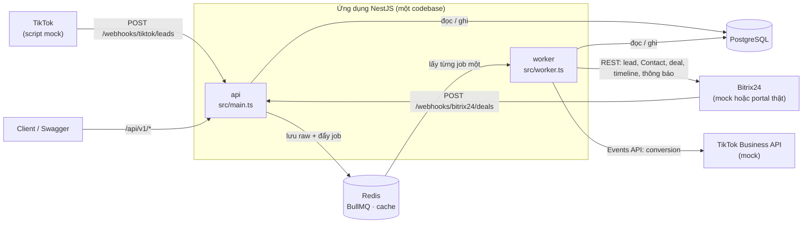
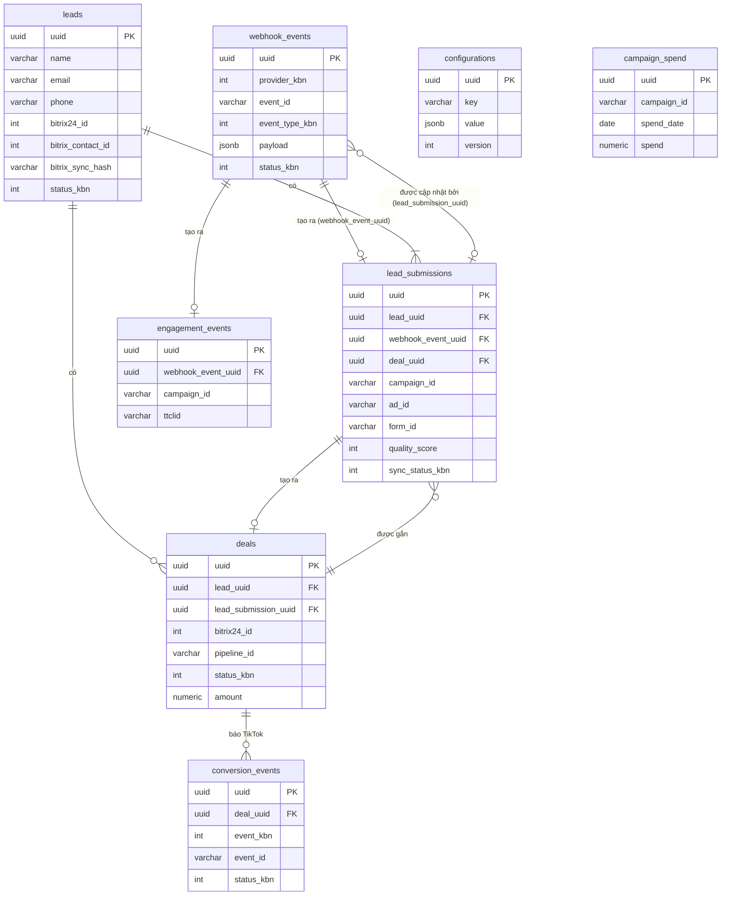

# Thiết kế `tiktok-bitrix`

Tài liệu giải thích ứng dụng hoạt động thế nào và vì sao chọn cách đó, đúng với code hiện tại. Các lựa chọn cho production mà đề không nhắc tới (worker riêng, chạy tuần tự, giới hạn tốc độ, chạy lại job lỗi…) được giải thích ở [readme_improvements.md](readme_improvements.md); tài liệu này chỉ tóm tắt và dẫn link. Ý nghĩa từng tệp xem [readme_structure.md](readme_structure.md); endpoint xem [readme_api.md](readme_api.md).

**Nguyên tắc thiết kế:** làm đủ yêu cầu của đề với ít bộ phận nhất. Mỗi sự kiện là **một job** làm trọn mọi bước theo thứ tự; các job chạy **lần lượt từng cái một**; job lỗi thì BullMQ thử lại chính job đó. Không có chuỗi job chuyền tay nhau, không có khóa, không có bảng phụ để theo dõi job.

**Mục lục:** [1. Tổng quan](#1-tổng-quan) · [2. Luồng dữ liệu](#2-luồng-dữ-liệu) · [3. Webhook TikTok](#3-nhận-webhook-tiktok) · [4. Module 1](#4-module-1-xử-lý-lượt-gửi-form) · [5. Đồng bộ lead](#5-module-2-đồng-bộ-lead-lên-bitrix24) · [6. Deal](#6-module-2-chuyển-lead-thành-deal) · [7. Webhook Bitrix24](#7-bitrix24-báo-deal-đổi-stage) · [8. Conversion](#8-báo-conversion-về-tiktok) · [9. Module 3](#9-module-3-thống-kê-và-báo-cáo) · [10. Queue](#10-hàng-đợi-và-job) · [11. DB](#11-cơ-sở-dữ-liệu) · [12. Mã kbn](#12-mã-kbn) · [13. Cấu hình](#13-cấu-hình) · [14. Redis](#14-redis-dùng-vào-việc-gì) · [15. Log](#15-ghi-log) · [16. Bảo mật](#16-bảo-mật-và-giới-hạn-tốc-độ-api) · [17. Công nghệ](#17-công-nghệ) · [18. Giả định](#18-giả-định) · [19. Hướng mở rộng](#19-giới-hạn-và-hướng-mở-rộng)

---

## 1. Tổng quan



| Process | Điểm khởi động | Làm gì | Không làm |
|---|---|---|---|
| `api` | `src/main.ts` | Nhận webhook (kiểm chữ ký, lưu raw, đẩy job, trả 200), API quản lý, cấu hình, thống kê, export, Swagger, `/health`. Chạy migration khi khởi động | Không ghi lên Bitrix24 hay TikTok, không chạy job. Với Bitrix24 chỉ đọc: danh sách field (`crm.lead.fields`, có cache) để kiểm mapping trước khi lưu, và deal (`crm.item.get`) khi kiểm điều kiện chuyển tay thành deal, để không trả `409` sai khi deal trong DB còn `OPEN` mà trên CRM đã đóng ([mục 6.7](#67-chuyển-tay)) |
| `worker` | `src/worker.ts` | Chạy job của queue `crm-pipeline` **lần lượt từng job một**, và các job định kỳ của queue `maintenance`. Luôn chỉ **một** process ([mục 10.1](#101-danh-sách-queue)) | Không mở cổng HTTP |
| `mock` | `src/mock-server.ts` | Giả Bitrix24 REST và TikTok Business API, ghi log mọi lệnh gọi, có endpoint điều khiển để demo (giả sales kéo deal, giả Bitrix24 quá tải) | Chỉ dùng khi demo và test |

Vì sao tách `api` và `worker`: [readme_improvements.md mục 1](readme_improvements.md#1-tách-worker-ra-process-riêng). Vì sao chạy lần lượt: [mục 2](readme_improvements.md#2-chạy-tuần-tự-một-job-mỗi-lúc).

| Nơi | Giữ gì |
|---|---|
| PostgreSQL | Mọi dữ liệu nghiệp vụ: raw webhook, khách, lượt gửi form, tương tác, deal, cấu hình, chi phí quảng cáo, conversion, thông báo, cảnh báo, báo cáo |
| Redis | Hàng đợi BullMQ (cả job lỗi, đóng vai dead letter queue), cache, bộ đếm giới hạn tốc độ Bitrix24 và API, nhịp tim worker. Mất Redis không mất dữ liệu nghiệp vụ ([mục 10.4](#104-mất-redis-thì-sao)) |
| Bitrix24 | Lead (mỗi khách một lead), Contact, Deal, timeline. Nơi sales làm việc |
| TikTok | Nguồn lead; nhận conversion báo ngược |

| Module của đề | Thư mục | Việc |
|---|---|---|
| 1. TikTok Lead Collection | `src/webhooks`, `src/leads` | Nhận webhook, kiểm chữ ký, lưu raw, chuẩn hóa, validate, chống trùng, chấm điểm |
| 2. Bitrix24 CRM Integration | `src/bitrix`, `src/lead-sync`, `src/deals`, `src/notifications` | Đồng bộ lead theo mapping, timeline, rule engine tạo deal, xác suất, gán sales, thông báo, nhận deal đổi stage |
| 3. Analytics & Reporting | `src/analytics`, `src/conversions`, `src/imports` | Chỉ số, dashboard API, export, báo cáo định kỳ, cảnh báo, conversion về TikTok, nhập dữ liệu cũ |

**Mô hình khách hàng.** Một khách là một lead trên Bitrix24, nhận diện bằng email **hoặc** SĐT, đúng như đề yêu cầu. Mỗi lần khách gửi form là một **lượt gửi** (`lead_submissions`), mang campaign, ad, form của lần đó. Một khách có nhiều lượt gửi và nhiều deal.

Vì sao tách hai bảng: bảng `leads` trong đề gộp thông tin một người (tên, email, SĐT) với thông tin một lần gửi form (`campaign_id`, `ad_id`, `raw_data`, `external_id`). Một người gửi form ở nhiều campaign, ad, form thì một dòng không chứa nổi: ghi đè thì mất campaign cũ, mỗi lần gửi một dòng thì một người thành nhiều lead và mất tác dụng chống trùng. Khác biệt so với schema của đề: [mục 11.3](#113-khác-với-schema-trong-đề). Mô hình tốt hơn khi khách đến từ nhiều mạng xã hội (chưa áp dụng vì lệch đề): [readme_improvements.md mục 9](readme_improvements.md#9-mô-hình-contact-cho-khách-đến-từ-nhiều-mạng-xã-hội).

---

## 2. Luồng dữ liệu

```
TikTok ──webhook──► api: kiểm chữ ký → INSERT webhook_events → đẩy job "tiktok-event" → 200
Sales kéo deal ──► Bitrix24 ──webhook──► api: kiểm token → INSERT webhook_events → đẩy job "bitrix-deal-event" → 200
Sales/admin ──POST convert-to-deal──► api: kiểm điều kiện → INSERT webhook_events (MANUAL) → đẩy job "convert-deal" → 202

worker: queue crm-pipeline, lần lượt từng job một (mục 10.1)

  job tiktok-event (một sự kiện TikTok, làm trọn từ đầu tới cuối)
    1. Kiểm sự kiện, chuẩn hóa, validate                                     (mục 4.1–4.3)
    2. Tìm khách, gộp dữ liệu, tạo hoặc cập nhật lượt gửi                    (mục 4.4)
    3. Đồng bộ khách lên Bitrix24: lead, Contact                             (mục 5.2, 5.3)
    4. Comment timeline cho lượt gửi                                         (mục 5.4)
    5. Chạy rule: gắn vào deal đang mở hoặc tạo deal mới                     (mục 6.1, 6.2)
    6. Deal: Contact → tạo deal → lead CONVERTED → comment lên deal          (mục 6.2)
    7. Thông báo cho sales; báo conversion DEAL_CREATED về TikTok            (mục 6.6, 8)
    8. Đánh dấu sự kiện PROCESSED, xóa current_step_kbn (chung transaction với bước 7)

  job bitrix-deal-event: đọc deal từ Bitrix24 → cập nhật stage, trạng thái, xác suất → thắng: báo DEAL_WON (mục 7, 8)
  job convert-deal: tạo dòng deal theo yêu cầu chuyển tay, rồi bước 6–7      (mục 6.7)

api: /api/v1/analytics/*, /api/v1/reports/* chỉ đọc PostgreSQL, cache Redis    (mục 9)
```

### 2.1 Chạy lại không làm hai lần

Job lỗi thì BullMQ thử lại **cả job**; batch `recovery` cũng chạy lại đúng job đó ([mục 10.2](#102-thử-lại-và-dlq)). Để lần chạy lại không làm lại bước đã xong, dòng `webhook_events` của sự kiện có cột `current_step_kbn`: bước đang làm, cũng là bước sẽ làm tiếp khi chạy lại ([mục 10.5](#105-chạy-tiếp-từ-bước-đang-dở)).

- Job bắt đầu từ bước ghi trong `current_step_kbn` (trống thì từ bước đầu), không đụng tới các bước trước nó.
- Mỗi bước ghi dữ liệu của nó **và** chuyển `current_step_kbn` sang bước sau trong **cùng một transaction**. Bước đã `COMMIT` thì chắc chắn không chạy lại; bước chưa `COMMIT` thì như chưa chạy.
- Bước cuối đặt `PROCESSED` và xóa `current_step_kbn`. Job chết ở đâu thì cột giữ đúng bước đó.
- Lệnh gọi Bitrix24, TikTok không nằm trong transaction được. Job chết sau khi bên kia đã nhận mà trước khi `COMMIT` thì bước đó chạy lại. Vì vậy **trước mọi lệnh tạo, cập nhật lead, Contact, deal trên Bitrix24, bước đó đọc bản ghi đích trước** (bắt buộc, [mục 5.5](#55-gọi-bitrix24)): đã có thì dùng lại, đã đúng thì không gửi, không còn trên CRM thì đi nhánh khác. Comment là ngoại lệ: chỉ kiểm trong DB, chấp nhận lặp một comment trong khoảng hở ([mục 5.4](#54-timeline)).

Các cột như `leads.bitrix24_id`, `bitrix_sync_hash`, `deals.bitrix24_id` vẫn được đọc, nhưng để trả lời câu hỏi nghiệp vụ của sự kiện sau cùng khách (khách đã có lead chưa, dữ liệu có đổi không, lượt gửi đã có deal chưa), không để đoán "sự kiện này đã làm bước này chưa". Câu đó chỉ `current_step_kbn` trả lời.

Số lần chạy, số vòng chạy lại, chết ở bước nào cũng nằm trong DB, trên dòng `webhook_events` của sự kiện (`attempt_count`, `retry_count`, `current_step_kbn`), để tra cứu và để batch chạy lại chỉ cần đọc DB (mục 10.2, 10.3). Mọi job của `crm-pipeline` đều có một dòng `webhook_events`: webhook TikTok, webhook Bitrix24, bản ghi import, và yêu cầu chuyển tay thành deal (nguồn `MANUAL`).

**Chỉ worker ghi dữ liệu nghiệp vụ.** Khách, lượt gửi, deal chỉ được ghi bởi job của `crm-pipeline`, lần lượt từng job một. Process `api` chỉ ghi `webhook_events`, `configurations`, `imports` và đẩy job; kể cả chuyển tay thành deal cũng đi qua job ([mục 6.7](#67-chuyển-tay)). Nhờ vậy không có hai nơi cùng ghi một khách hay một deal, và không cần khóa nào.

Mỗi bước chỉ `UPDATE` đúng các cột của nó, không ghi đè cả dòng (không dùng `save()` của TypeORM trên entity đọc từ trước), để dữ liệu do nơi khác ghi (cấu hình, trạng thái do Bitrix24 báo về) không bị xóa mất.

---

## 3. Nhận webhook TikTok

### 3.1 Ba loại sự kiện

Đề liệt kê ba loại: lead submission, form completion, user interaction. Webhook lead **thật** của TikTok API for Business chỉ có một loại (có lead mới), dạng `{ "object": 1, "entry": [ … ] }`. Bài nộp nhận đúng payload mẫu của đề, và tự định nghĩa hai loại còn lại:

| `event` | Nghĩa | Có thông tin cá nhân | Xử lý |
|---|---|---|---|
| `lead.generate` | Khách gửi form (payload mẫu của đề) | Có | Tạo lượt gửi, đồng bộ lead, chạy rule |
| `form.complete` | Khách trả lời xong các câu hỏi bổ sung của form nhiều bước. Cùng cấu trúc với `lead.generate` (giả định) | Có | Cập nhật lượt gửi trước đó của cùng form, không tạo lượt gửi mới ([mục 4.4](#44-tìm-khách-trùng-và-gộp-dữ-liệu)) |
| `user.interaction` | Khách bấm quảng cáo, mở form (giả định) | Không | Chỉ lưu `engagement_events`, dùng cho điểm chất lượng và phễu. Không đẩy lên Bitrix24 |
| Khác | | | Lưu raw với trạng thái `IGNORED`, trả 200 để TikTok không gửi lại |

Payload `user.interaction` (giả định):

```json
{
  "event": "user.interaction",
  "event_id": "evt_1234567001",
  "timestamp": 1709876400,
  "advertiser_id": "7123456789",
  "campaign": { "campaign_id": "1234567890123456789", "campaign_name": "Spring Sale 2024",
                "ad_id": "9876543210987654321", "ad_name": "Product Demo Video" },
  "form": { "form_id": "form_abc123", "form_name": "Contact Form" },
  "interaction": { "type": "form_open", "ttclid": "TT-abc123xyz789" }
}
```

`interaction.type`: `ad_click` hoặc `form_open`. Nhận payload thật của TikTok là hướng mở rộng ([mục 19](#19-giới-hạn-và-hướng-mở-rộng)).

### 3.2 Một request đi qua những bước nào

```
POST /webhooks/tiktok/leads
  1. TikTokSignatureGuard   kiểm TikTok-Signature trên raw body (3.3)                  sai → 401, không lưu
  2. Đọc body               JSON, có event_id                                           sai → 400, không lưu
  3. INSERT webhook_events  provider TIKTOK, status RECEIVED, payload nguyên văn
                            ON CONFLICT (provider_kbn, event_id) DO NOTHING RETURNING uuid
       có dòng mới          → bước 4
       trùng, dòng cũ đã PROCESSED / INVALID / IGNORED   → 200, dừng
       trùng, dòng cũ còn RECEIVED / FAILED              → bước 4
  4. Đẩy job tiktok-event   jobId evt-{webhook_event_uuid}
       job đang chờ, đang chạy               → giữ nguyên
       job ở dead letter queue (FAILED)      → job.retry, chạy lại từ bước đang dở
       không có job (lần trước đẩy chưa được) → thêm job
  5. Trả 200                { "received": true }
  Bước 3 hoặc 4 lỗi (DB hoặc Redis sập) → 500 → TikTok gửi lại
```

| Tình huống | Trả | Lưu `webhook_events` |
|---|---|---|
| Thiếu hoặc sai chữ ký | `401` (`20010`) | Không, chỉ ghi log: tránh để request giả làm đầy DB |
| `t` lệch quá `TIKTOK_SIGNATURE_TOLERANCE_SECONDS` (mặc định 300 giây) | `401` (`20011`) | Không |
| Body không phải JSON, thiếu `event_id` | `400` (`20001`) | Không |
| Trùng `event_id` đã xử lý | `200` | Không thêm dòng |
| `event` không hỗ trợ | `200` | Có, `IGNORED` |
| DB hoặc Redis lỗi | `500` | TikTok gửi lại; lần sau đi tiếp từ bước 3 |

- TikTok chỉ đọc mã trạng thái: không phải 200 là gửi lại, trong tối đa 72 giờ, thời gian chờ tăng dần ([TikTok for Developers – Webhooks overview](https://developers.tiktok.com/doc/webhooks-overview)). Vì vậy request trùng vẫn phải trả 200, và lúc hạ tầng lỗi thì cứ trả 500: **cơ chế gửi lại của TikTok chính là đường phục hồi**, ứng dụng không phải tự làm.
- Request chỉ có một câu INSERT và một lệnh đẩy job, vài mili giây. Mọi xử lý nặng nằm ở worker.
- Kết nối Redis dùng để đẩy job đặt `enableOfflineQueue: false`, như BullMQ khuyên cho bên đẩy job ([Going to production](https://docs.bullmq.io/guide/going-to-production)): Redis sập thì lệnh đẩy báo lỗi ngay và trả 500, thay vì treo request.
- Endpoint công khai (`@Public()`), không cần `x-api-key`; được bảo vệ bằng chữ ký. Giới hạn tốc độ riêng, cao hơn API quản lý ([mục 16](#16-bảo-mật-và-giới-hạn-tốc-độ-api)).

### 3.3 Chữ ký

Theo format TikTok công bố cho webhook của TikTok for Developers ([Webhooks verification](https://developers.tiktok.com/doc/webhooks-verification)):

```
TikTok-Signature: t=1709876543,s=8b2c6f0e9a4d…5a8f0c6b

signed_payload = "{t}.{raw body}"
expected       = hex(HMAC_SHA256(TIKTOK_WEBHOOK_SECRET, signed_payload))
hợp lệ khi     |now − t| ≤ 300 giây  và  timingSafeEqual(expected, s)
```

- Ký trên **raw body**, đúng từng byte TikTok gửi: tạo app với `NestFactory.create(ApiModule, { rawBody: true })`, guard đọc `req.rawBody`. Băm lại từ object đã parse sẽ ra chữ ký khác (khoảng trắng, thứ tự khóa).
- So sánh trong thời gian không đổi (`safeEquals`, dùng lại từ `gg-sheets-bitrix`).
- Script mock ký theo đúng công thức này ([readme_run.md bước 6](readme_run.md#6-demo)).
- Webhook lead của TikTok API for Business có thể dùng header khác (một số nguồn ghi `X-Open-Signature`); header theo đề là `TikTok-Signature`. Tên header và cách ghép chuỗi nằm trong một lớp, đổi được mà không sửa phần còn lại.

### 3.4 Chống nhận trùng

TikTok cam kết gửi "ít nhất một lần": trả chậm, timeout, hoặc 200 bị mất trên đường mạng đều làm TikTok gửi lại cùng sự kiện, có thể sau vài phút hoặc vài giờ.

| Lớp | Cách | Vì sao |
|---|---|---|
| PostgreSQL | `INSERT … ON CONFLICT (provider_kbn, event_id) DO NOTHING RETURNING uuid` trên index UNIQUE | Một câu lệnh vừa lưu raw vừa biết có trùng không; giữ mãi, không phụ thuộc thời hạn |
| BullMQ | `jobId = evt-{webhook_event_uuid}` | BullMQ bỏ qua lệnh thêm job nếu `jobId` đó còn trong queue ([Job Ids](https://docs.bullmq.io/guide/jobs/job-ids)), nên đẩy lại bao nhiêu lần cũng chỉ có một job. Job nằm trong tập failed cũng tính là còn, nên sự kiện `FAILED` được đẩy lại bằng `job.retry` (3.2) |

---

## 4. Module 1: xử lý lượt gửi form

Bước 1–2 của job `tiktok-event` ([mục 2](#2-luồng-dữ-liệu)).

### 4.1 Chuẩn hóa payload

Đọc `webhook_events.payload`; sự kiện đã `PROCESSED`, `INVALID`, `IGNORED` thì dừng ngay. Payload đi qua một **adapter** để ra dạng chuẩn dùng cho mọi bước sau. Dạng chuẩn trùng cấu trúc payload mẫu của đề, vì mapping của đề dùng đường dẫn như `lead_data.email`, `campaign.campaign_name`.

```ts
interface NormalizedLeadEvent {
  event: 'lead.generate' | 'form.complete';
  event_id: string;
  timestamp: number;                 // giây
  advertiser_id?: string;
  campaign: { campaign_id?: string; campaign_name?: string; ad_id?: string; ad_name?: string };
  form: { form_id?: string; form_name?: string };
  lead_data: {
    full_name: string; email?: string; phone?: string; city?: string; interests?: string[];
    utm_source?: string; utm_campaign?: string; ttclid?: string;
  };
  custom_questions: { question: string; answer: string }[];
}
```

Có một adapter cho payload của đề. Nguồn khác (payload thật của TikTok, file import) chỉ cần thêm adapter.

### 4.2 Validate và làm sạch

DTO kiểm bằng `class-validator`. Sai thì `webhook_events.status_kbn = INVALID`, ghi `error_kbn = 20001` và chi tiết từng trường, rồi kết thúc job bình thường (không thử lại: gửi lại vẫn sai).

| Trường | Luật | Làm sạch |
|---|---|---|
| `event_id` | Bắt buộc, tối đa 255 ký tự | |
| `timestamp` | Bắt buộc, số giây hợp lệ | Lưu thành `submitted_at` |
| `lead_data.full_name` | Bắt buộc sau làm sạch, tối đa 255 | Bỏ thẻ HTML và ký tự điều khiển, gộp khoảng trắng, chuẩn Unicode NFC |
| `lead_data.email`, `phone` | Có ít nhất một giá trị **hợp lệ** sau chuẩn hóa (4.3); không có thì `20014` | Giá trị sai định dạng bị bỏ, ghi vào `lead_submissions.warnings`; lượt gửi vẫn nhận nếu còn giá trị kia |
| `lead_data.city`, `utm_*`, `ttclid` | Chuỗi, tối đa 255 | Như `full_name` |
| `lead_data.interests` | Mảng chuỗi, tối đa 20 phần tử | Như trên, bỏ phần tử rỗng |
| `custom_questions[]` | Tối đa 50 câu; câu hỏi tối đa 255, câu trả lời tối đa 1000 | Như trên |
| `campaign.*`, `form.*` | Chuỗi, tối đa 255 | |

Bỏ giá trị sai thay vì loại cả lượt gửi: khách gõ sai email nhưng SĐT đúng vẫn là một khách sales gọi được.

### 4.3 Chuẩn hóa email và SĐT

| Trường | Quy tắc | Ví dụ |
|---|---|---|
| Email | Bỏ khoảng trắng hai đầu, chữ thường, kiểm định dạng | `" NguyenVanA@Email.com "` → `nguyenvana@email.com` |
| SĐT | `libphonenumber-js`, vùng mặc định `PHONE_DEFAULT_REGION` (`VN`), kiểm số hợp lệ, xuất E.164 | `0901 234 567`, `+84 90 123 4567`, `84901234567` → `+84901234567` |

E.164 là chuẩn quốc tế mà đề yêu cầu, cũng là dạng Events API của TikTok bắt buộc trước khi băm (mục 8). Không gộp các biến thể Gmail (dấu chấm, `+tag`): đó là hai địa chỉ khác nhau về mặt kỹ thuật.

### 4.4 Tìm khách trùng và gộp dữ liệu

Bước 2 của job. Bước chỉ ghi DB, nên chạy đúng một lần nhờ `current_step_kbn` ghi cùng transaction ([mục 10.5](#105-chạy-tiếp-từ-bước-đang-dở)).

Khách trùng khi khớp **email hoặc SĐT** với một lượt gửi đã có của khách đó:

```sql
SELECT lead_uuid, bool_or(email = :email) AS by_email
FROM lead_submissions
WHERE email = :email OR phone = :phone
GROUP BY lead_uuid
ORDER BY by_email DESC, min(submitted_at)
LIMIT 1;
```

- Tìm trên `lead_submissions` chứ không trên `leads`: khách đổi SĐT thì `leads.phone` mang số mới, nhưng số cũ vẫn nằm ở lượt gửi cũ, nên lần sau khách dùng lại số cũ vẫn ra đúng khách.
- Email khớp khách A, SĐT khớp khách B: chọn A (email ưu tiên). Không tự gộp A và B.
- Không cần khóa: job chạy lần lượt từng cái một ([mục 10.1](#101-danh-sách-queue)), nên không có hai job cùng tìm rồi cùng tạo một khách.

**Gộp vào `leads`** theo thời điểm gửi form, không theo thứ tự xử lý:

| Lượt gửi | `name`, `email`, `phone`, `city` |
|---|---|
| Khách mới | Lấy từ lượt gửi |
| `submitted_at` ≥ `leads.last_submitted_at` | Giá trị khác rỗng ghi đè; ô trống không xóa dữ liệu cũ |
| Cũ hơn (TikTok gửi lại muộn, dữ liệu import) | Chỉ điền ô đang trống |

Trong một transaction: tạo hoặc cập nhật `leads`, INSERT `lead_submissions` (`sync_status_kbn = PENDING`, `quality_score`), ghi `webhook_events.lead_submission_uuid`.

**Sự kiện `form.complete`** là bước hoàn tất của chính lượt gửi trước đó, không phải lượt gửi mới. Sau khi tìm ra khách:

| Tìm thấy lượt gửi của khách cùng `form_id`, gửi trong `FORM_COMPLETE_WINDOW_HOURS` (24 giờ), chưa có `completed_at` | Xử lý |
|---|---|
| Có | Cập nhật lượt gửi đó: câu trả lời (thêm câu mới, câu cũ lấy giá trị mới), dữ liệu khách, điểm chất lượng, `completed_at`; đặt lại `sync_status_kbn = PENDING`. **Giữ nguyên `event_type_kbn`** (loại sự kiện đã tạo ra lượt gửi), để thống kê theo loại sự kiện không lệch. Các bước sau của job chạy cho lượt gửi này: đồng bộ dữ liệu mới lên Bitrix24, comment ngắn về câu trả lời mới (5.4), chạy lại rule nếu lượt gửi chưa có deal (6.2) |
| Không | Tạo lượt gửi mới như `lead.generate`, `event_type_kbn = FORM_COMPLETE`, có luôn `completed_at` (khách mở form cũ hơn 24 giờ, hoặc bước đầu bị mất) |

Một lượt gửi vì vậy có thể có nhiều sự kiện: `lead_submissions.webhook_event_uuid` là sự kiện đã tạo ra nó, `webhook_events.lead_submission_uuid` là lượt gửi mà từng sự kiện tạo ra hoặc cập nhật.

### 4.5 Điểm chất lượng

Mỗi lượt gửi một điểm từ 0 đến 100, lưu ở `lead_submissions.quality_score`. Điểm hiện tại của khách là điểm của lượt gửi mới nhất.

| Thành phần | Điểm |
|---|---|
| Có email hợp lệ | 10 |
| Có SĐT hợp lệ | 10 |
| Số câu hỏi bổ sung có câu trả lời (khác rỗng sau làm sạch) | 0 câu: 0 · 1 câu: 10 · ≥ 2 câu: 20 |
| Ngân sách (câu hỏi có chữ "budget" hoặc "ngân sách") | ≥ 10 triệu: 20 · 5–10 triệu: 15 · < 5 triệu: 5 · không đọc được: 0 |
| Thời gian dự định mua (câu hỏi có chữ "timeline" hoặc "thời gian") | ≤ 1 tháng: 20 · trên 1 đến 3 tháng: 10 · trên 3 tháng: 5 · không đọc được: 0 |
| Tương tác trước đó cùng `ttclid` (`engagement_events`) | 0 lần: 0 · 1 lần: 10 · ≥ 2 lần: 20 |

Payload mẫu của đề: 10 + 10 + 20 (2 câu có trả lời) + 15 ("5-10 triệu VND") + 20 ("Trong 1 tháng") + 0 = **75**.

- Đọc số tiền: lấy các số trong câu trả lời, nhân theo đơn vị (`triệu`, `tr`, `million` = 10⁶; `tỷ` = 10⁹), khoảng thì lấy giá trị giữa. "5-10 triệu VND" → 7.500.000.
- Đọc thời gian mua, ra số tháng:
  - Từ khóa "ngay", "càng sớm càng tốt", "asap", "immediately" → 0 tháng.
  - Còn lại lấy các số trong câu trả lời và đơn vị đứng sau: `ngày`, `day` ÷ 30 · `tuần`, `week` ÷ 4 · `tháng`, `month` × 1 · `năm`, `year` × 12 (chữ thường, bỏ dấu, nhận cả số nhiều `days`, `months`). Khoảng thì lấy giá trị giữa, như phần tiền.
  - "Trong 1 tháng" → 1 → 20 điểm · "2-3 tháng" → 2,5 → 10 · "6 months" → 6 → 5 · "1 tuần" → 0,25 → 20.
  - Có số mà không có đơn vị ("3"), hoặc không có số lẫn từ khóa ("chưa biết"): không đọc được, 0 điểm.
- Đếm số câu có trả lời chứ không tính tỉ lệ: payload chỉ liệt kê các cặp câu hỏi, câu trả lời mà TikTok gửi, không cho biết form có bao nhiêu câu. Nếu TikTok bỏ câu không trả lời khỏi payload thì tỉ lệ luôn là 100%.
- Câu hỏi ngân sách, thời gian mua cũng được đếm ở dòng số câu có trả lời.
- Công thức nằm trong một service, có unit test; đề không quy định nên đây là đề xuất ([mục 18](#18-giả-định)).

### 4.6 Sự kiện tương tác

`user.interaction` không có thông tin cá nhân nên không gắn được với một khách. Job ghi một dòng `engagement_events` (campaign, ad, form, loại tương tác, `ttclid`, thời điểm; `ON CONFLICT (webhook_event_uuid) DO NOTHING`) rồi đặt sự kiện `PROCESSED`. Dùng ở hai chỗ:

- Điểm chất lượng của lượt gửi có cùng `ttclid` (4.5).
- Phễu ở Module 3: số tương tác → số lượt gửi theo campaign, ad, form ([mục 9.2](#92-chỉ-số-và-công-thức)).

---

## 5. Module 2: đồng bộ lead lên Bitrix24

Bước 3–4 của job `tiktok-event`.

### 5.1 Mapping

Giữ đúng format của đề: đường dẫn trong dữ liệu khách → mã field Bitrix24. Lưu trong `configurations.key = 'field_mapping'`, sửa qua `PUT /api/v1/config/mappings`.

```json
{
  "lead_data.full_name": "NAME",
  "lead_data.email": "EMAIL[0][VALUE]",
  "lead_data.phone": "PHONE[0][VALUE]",
  "lead_data.city": "UF_CRM_CITY",
  "campaign.campaign_name": "UF_CRM_UTM_CAMPAIGN",
  "campaign.ad_name": "UF_CRM_AD_NAME",
  "lead_data.ttclid": "UF_CRM_TTCLID",
  "lead_data.utm_source": "UTM_SOURCE",
  "lead_data.utm_campaign": "UTM_CAMPAIGN"
}
```

Bảy dòng đầu là mapping mẫu của đề; hai dòng UTM thêm vào bản mặc định vì đó là field chuẩn của lead Bitrix24.

**Dữ liệu khách đem đi map** là bản mới nhất, ghép từ hai nơi:

| Đường dẫn | Lấy từ |
|---|---|
| `lead_data.full_name`, `email`, `phone`, `city` | `leads` (bản đã gộp, mục 4.4) |
| `lead_data.interests`, `utm_*`, `ttclid`, `campaign.*`, `form.*`, `custom_questions`, `event`, `advertiser_id` | Lượt gửi có `submitted_at` lớn nhất của khách |

**Đích:** `FIELD` (field thường hoặc custom `UF_CRM_*`) hoặc `FIELD[0][VALUE]` (field nhiều giá trị như `EMAIL`, `PHONE`). Giá trị được đổi theo **kiểu field** đọc từ `crm.lead.fields` (cache Redis 10 phút). `gg-sheets-bitrix` có sẵn bộ đổi số, ngày, danh sách và `Y`/`N` (`toYesNo`), nhận đầu vào là ô Google Sheets (`SheetCell`): chép sang rồi đổi đầu vào thành giá trị trong payload. Bộ đổi chuỗi và field nhiều giá trị viết mới:

| Kiểu field Bitrix24 | Ví dụ | Gửi lên |
|---|---|---|
| `string` | `NAME`, `UF_CRM_CITY` | Chuỗi; mảng thì nối bằng `, ` |
| `double`, `integer` | `OPPORTUNITY` | Số |
| `crm_multifield` | `EMAIL`, `PHONE` | `[{ "VALUE": "…", "VALUE_TYPE": "WORK" }]` |
| `enumeration` | `UF_CRM_…` danh sách | ID lựa chọn, tìm theo tên |
| `date`, `datetime` | `UF_CRM_…` | `YYYY-MM-DD`, ISO 8601 |
| `boolean`, `char` | | `Y` / `N` |

**Field do ứng dụng tự điền**, mapping không được ghi vào (`PUT` báo `20004`):

| Field | Giá trị |
|---|---|
| `TITLE` | `{full_name} · TikTok` |
| `SOURCE_ID`, `SOURCE_DESCRIPTION` | Nguồn, campaign, form của lượt gửi **đầu tiên** ([mục 5.6](#56-nguồn-của-khách-trên-lead)) |
| `UF_CRM_SOURCES` | Mọi nguồn khách đã đến ([mục 5.6](#56-nguồn-của-khách-trên-lead)) |
| `COMMENTS` | Câu hỏi bổ sung và câu trả lời của lượt gửi mới nhất |
| `ORIGINATOR_ID`, `ORIGIN_ID` | `tiktok-bitrix`, `leads.uuid`: để tra ngược lead Bitrix24 về khách trong DB |

**Kiểm tra khi lưu mapping:** JSON đúng dạng; mỗi đường dẫn thuộc danh sách đường dẫn hỗ trợ; mỗi field tồn tại trên portal, sửa được, kiểu được hỗ trợ; không trùng field (trừ field nhiều giá trị); không ghi vào field tự điền; `version` gửi lên khớp bản đang lưu (lệch thì `409`, `20009`). Lưu xong xóa cache. Hash của mọi khách đổi theo mapping mới, nên lần đồng bộ kế tiếp của mỗi khách tự đẩy field mới lên.

### 5.2 Một lần đồng bộ

```
Bước 3a: đồng bộ khách L lên lead Bitrix24
  fields = mapping(dữ liệu khách mới nhất) + field tự điền
  hash   = SHA-256(fields)

  leads.bitrix24_id có → crm.lead.get
    không còn (sales xóa, hoặc gộp vào lead khác) → xóa leads.bitrix24_id, ghi warnings, đi nhánh "trống"
    còn, hash khác leads.bitrix_sync_hash → UPDATED:   crm.lead.update (5.3) → lưu hash
    còn, hash bằng                        → UNCHANGED: không ghi
  leads.bitrix24_id trống
    một request batch: crm.lead.list lọc ORIGIN_ID = L.uuid
                     + crm.duplicate.findbycomm (entity_type LEAD) theo EMAIL và theo PHONE
      thấy theo ORIGIN_ID → lead do chính ứng dụng tạo ở lần chạy trước mà chưa kịp lưu ID: gắn như LINKED
      thấy theo email/SĐT → bỏ các lead đã là bitrix24_id của khách khác trong DB (xem dưới)
        còn lead X  → LINKED:  crm.lead.get X → crm.lead.update X (5.3)
        không còn   → CREATED: crm.lead.add
    → lưu leads.bitrix24_id, bitrix_sync_hash, status IN_CRM

Bước 3b: Contact (chỉ khi khách đã có Contact, 6.2)
  tên/email/SĐT khác leads.bitrix_contact_hash → crm.item.get Contact
    không còn → xóa leads.bitrix_contact_id, ghi warnings (deal sau của khách tạo lại Contact ở 6a)
    còn       → crm.item.update: tên mới, email/SĐT Contact chưa có thì thêm bằng khóa fm "n0", "n1"…
                (giá trị cũ giữ nguyên)
    → lưu bitrix_contact_hash
```

- Mỗi "lưu" ở trên nằm chung transaction với việc chuyển `current_step_kbn` sang bước sau (2.1).
- Hash để không gọi Bitrix24 khi dữ liệu khách không đổi, không phải dấu chạy lại. Bước 3a cập nhật lead mà lỗi thì hash chưa được lưu và `current_step_kbn` vẫn ở 3a, nên lần chạy lại gửi lại.
- Mọi lệnh ghi ở trên có lệnh đọc đi trước (5.5). `EMAIL`, `PHONE` của lead và `fm` của Contact không kèm ID là **thêm** giá trị, nên phải biết giá trị đang có; chạy lại mà không đọc thì lead, Contact có hai email giống nhau.
- **Lead bị xóa hoặc bị gộp trên CRM.** Sales gộp hai lead trùng thì Bitrix24 giữ một và xóa lead kia: `crm.lead.get` báo không còn, ứng dụng tra lại theo email/SĐT và gắn vào lead còn lại (LINKED). Bị xóa hẳn thì tạo lead mới, vì khách vừa gửi form mới, và ghi `warnings` "Lead cũ #X không còn trên CRM" (hiện trong comment của bước 4). Khách chuyển sang bản ghi lead khác thì `leads.status_kbn` đặt lại `IN_CRM`: `CONVERTED` là trạng thái của lead cũ, bước 6c chuyển lead mới khi lượt gửi có deal. Không đọc trước thì `crm.lead.update` lỗi `40007` (không tìm thấy), lỗi không thử lại được, và khách kẹt ở đó mãi.
- Chỉ đẩy **bản dữ liệu khách mới nhất**, và chỉ khi nó đổi ([readme_improvements.md mục 6](readme_improvements.md#6-chỉ-đẩy-dữ-liệu-khách-mới-nhất-lên-bitrix24)).

**Lead trên CRM đã thuộc khách khác.** Sales có thể tự thêm một email vào lead X của khách A trên CRM. Sau đó khách B (mới trong DB, vì email đó chưa từng xuất hiện ở lượt gửi nào) dùng email ấy, và tra trùng trên Bitrix24 trả về X. Gắn B vào X sẽ phạm UNIQUE `leads.bitrix24_id` và làm hai khách dùng chung một lead. Ứng dụng bỏ X khỏi kết quả tra trùng, tạo lead mới cho B, và ghi `warnings` "Có thể trùng lead X (cùng email)" vào lượt gửi; câu này hiện trong comment của bước 4. Sales gộp trên CRM nếu đúng là một người: tách nhầm ít hại hơn gộp nhầm ([readme_improvements.md mục 8](readme_improvements.md#8-định-danh-khách-hàng-bằng-emailsđt-kèm-tên)).

### 5.3 Cập nhật lead đã có

- Chỉ gửi các field khác lần đồng bộ thành công trước (so với `fields` đã băm lần trước, lưu cùng hash trong `leads.bitrix_synced_fields`).
- `EMAIL`, `PHONE`: Bitrix24 hiểu giá trị không kèm `ID` trong lệnh update là **thêm** giá trị mới. Lệnh cập nhật luôn có `crm.lead.get` đi trước (5.2), nên biết các giá trị đang có, chỉ gửi giá trị chưa có; số cũ vẫn giữ trên CRM để sales thấy cả hai. Giống quy ước #6 của `gg-sheets-bitrix`.
- Bản đọc **không** dùng để so từng field với CRM rồi ghi đè: field đơn chỉ gửi khi dữ liệu của khách đổi so với lần đồng bộ trước (dòng đầu), nên sales sửa tay trên CRM không bị ghi đè.
- `SOURCE_ID`, `SOURCE_DESCRIPTION` không bao giờ gửi lại sau khi tạo.
- Field sales sửa trên CRM (ví dụ `STATUS_ID`, `ASSIGNED_BY_ID`) không nằm trong mapping thì không bị ghi đè. Ngoại lệ duy nhất: `STATUS_ID` được đặt `CONVERTED` một lần, khi khách có deal đầu tiên (6.2).
- Lead đã `CONVERTED` mà Bitrix24 từ chối cập nhật: bỏ qua lệnh cập nhật lead, ghi `warnings`, vẫn cập nhật Contact. Hành vi này cần kiểm trên portal thật; mock cho cập nhật.

### 5.4 Timeline

Bước 4 của job. Mỗi lượt gửi một comment, để sales thấy khách đã gửi form những lần nào:

```
Lead từ TikTok · Campaign: Spring Sale 2024 · Ad: Product Demo Video · Form: Contact Form
Gửi lúc 08/03/2024 12:42 · Điểm: 75 · Budget range: 5-10 triệu VND · Timeline: Trong 1 tháng
Lưu ý: Có thể trùng lead #12 (cùng email)
Mã: 6f1d2c3a
```

- Dòng "Lưu ý" lấy từ `lead_submissions.warnings` của bước 3a (lead nghi trùng, lead cũ không còn trên CRM), chỉ có khi có cảnh báo. Bước 3a không tự comment: mọi comment đều đi qua bước 4 (hoặc 6d trên deal) và được kiểm như bảng dưới.
- "Mã" là 8 ký tự đầu của `webhook_events.uuid`, cũng là mã trong log (mục 15), **chỉ để tra log**: từ một comment trên CRM, `grep 6f1d2c3a logs/services/*.log` ra toàn bộ log của sự kiện đó. Mã không dùng để kiểm trùng.

Ghi lên lead; khách đã `CONVERTED` và có Contact thì ghi lên **Contact** (`ENTITY_TYPE = contact`), vì sales không còn xem lead đã chuyển đổi. Comment hay không do DB quyết định, theo câu hỏi "**lượt gửi này** đã có comment chưa", không phải "sự kiện này đã comment chưa":

| `timeline_posted_at` của lượt gửi | Sự kiện | Bước 4 làm gì |
|---|---|---|
| Trống | `lead.generate` hoặc `form.complete` | Comment đầy đủ với câu trả lời mới nhất; lưu `timeline_posted_at` (`form.complete` lưu cả `completion_posted_at`) |
| Có | `lead.generate` | Không comment |
| Có | `form.complete`, `completion_posted_at` trống (4.4) | Comment ngắn với các câu trả lời mới; lưu `completion_posted_at` |
| Có | `form.complete`, `completion_posted_at` có | Không comment |

Ví dụ: sự kiện E1 (`lead.generate`) chết trước bước 4, E2 (`form.complete` cùng lượt gửi) chạy trước và comment đầy đủ. E1 chạy lại thấy `timeline_posted_at` đã có, không comment nữa.

**Khoảng hở được chấp nhận.** Bitrix24 đã lưu comment mà job chết, hoặc lệnh comment bị timeout dù Bitrix24 đã lưu, trước khi kịp lưu thời điểm: lần chạy lại comment thêm một lần. Comment không được đọc trước như lead, deal (5.5), vì cái giá cao hơn cái được:

- Giá: mỗi comment thêm một request đọc, ở mọi lần chạy, trong khi Bitrix24 chỉ cho khoảng 2 request mỗi giây cho cả portal; thêm một cơ chế riêng để viết và kiểm thử.
- Được: tránh một dòng lịch sử lặp, chỉ khi sự cố rơi đúng khoảng hở. Không phần nào đọc lại comment, nên lead, deal, thông báo, số liệu đều không sai.

- Bitrix24 **từ chối** comment (sai quyền, dữ liệu): ghi `warnings`, job vẫn sang bước 5. Dữ liệu khách đã lên CRM; comment chỉ là lịch sử, không đáng để chặn việc tạo deal.
- Lỗi **tạm thời** (quá tải, timeout): job thử lại như 5.5; `current_step_kbn` vẫn ở bước 4 nên lần sau comment tiếp.
- Bước 3–4 xong thì `sync_status_kbn = SUCCESS`, `synced_at`.

### 5.5 Gọi Bitrix24

Mọi lệnh gọi đi qua `Bitrix24Client` (dùng lại `call()`, `callBatch()`, bộ đổi lỗi của `gg-sheets-bitrix`), thêm:

- Giới hạn tốc độ dùng chung qua Redis (token bucket, `BITRIX24_MAX_RPS` = 2, `BITRIX24_BURST` = 10) ([readme_improvements.md mục 3](readme_improvements.md#3-giới-hạn-tốc-độ-chung-khi-gọi-bitrix24)).
- Các lệnh độc lập với nhau gộp vào một request `batch` (tối đa 50 lệnh), ví dụ tra trùng theo email và theo SĐT: một request thay vì hai.
- Timeout `HTTP_TIMEOUT_MS`; không thử lại bên trong lệnh gọi, thử lại ở tầng job.
- Lỗi đổi thành `error_kbn` 4xxxx. Lỗi tạm thời ném lỗi thường, BullMQ thử lại cả job. Lỗi không thử lại được (`40003` sai quyền, `40008` Bitrix24 từ chối dữ liệu) ném `UnrecoverableError` để job dừng ngay ([readme_improvements.md mục 4](readme_improvements.md#4-thử-lại-dead-letter-queue-và-batch-chạy-lại)).

**Đọc trước khi ghi (bắt buộc).** Trước mọi lệnh tạo, cập nhật lead, Contact, deal trên Bitrix24, bước đó đọc bản ghi đích trong cùng lần chạy rồi mới quyết định ghi gì:

- **Đã có**: lần chạy trước Bitrix24 đã nhận lệnh mà job chết trước khi lưu kết quả (10.5). Dùng cái đã có, không tạo lần hai.
- **Không còn**: sales xóa hoặc gộp trên CRM. Đi nhánh khác ngay, thay vì lệnh ghi lỗi `40007` và job dừng.
- **Đã đúng**: không gửi.
- **Field nhiều giá trị** (email, SĐT): gửi không kèm ID là thêm, nên phải biết giá trị đang có.

| Lệnh ghi | Đọc trước | Đã có, đã đúng | Không còn trên CRM |
|---|---|---|---|
| Tạo lead (3a) | Một batch: `crm.lead.list` lọc `ORIGIN_ID` + `crm.duplicate.findbycomm` | Gắn vào lead đó | |
| Cập nhật lead (3a) | `crm.lead.get` | Chỉ gửi field đổi, email/SĐT chưa có | Tra lại, gắn hoặc tạo mới (5.2) |
| Cập nhật Contact (3b) | `crm.item.get` (entityTypeId 3) | Chỉ thêm email/SĐT chưa có | Xóa `bitrix_contact_id`, tạo lại ở deal sau |
| Gắn lượt gửi vào deal đang mở (5, 6.7) | Deal đã có `bitrix24_id`: `crm.item.get` (entityTypeId 2); chưa có: không đọc, gắn luôn | Đang xử lý (`P`): gắn. Đã thắng, thua (`S`, `F`): cập nhật `WON` / `LOST`, tạo deal mới | Deal `DELETED`, tạo deal mới |
| Tạo Contact (6a) | Contact đã lưu: `crm.item.get`; chưa có: `crm.item.list` lọc `originId` + `crm.duplicate.findbycomm`, thấy thì `crm.item.get` Contact đó | Dùng Contact đó, thêm email/SĐT chưa có (không đổi tên) | Tra lại, dùng hoặc tạo mới |
| Tạo deal (6b) | `crm.item.list` lọc `originId = deals.uuid` | Lưu `bitrix24_id` | |
| Lead `CONVERTED` (6c) | `crm.lead.get` | `STATUS_ID` đã `CONVERTED`: chỉ lưu DB | `warnings`, sang bước sau |
| Xác suất deal (`BX_PROBABILITY`, mục 7) | `crm.item.get` (entityTypeId 2) | Bằng giá trị cần: không gửi | Deal `DELETED` |

- Ngoại lệ:
  - Comment timeline, comment lên deal: không đọc, chỉ kiểm trong DB lượt gửi đã có comment chưa; chấp nhận lặp một comment trong khoảng hở (5.4). Bản ghi đích không còn thì lệnh comment lỗi `40007`: ghi `warnings`, sang bước sau.
  - Thông báo `im.notify.system.add` (gửi lại cùng `TAG` thì Bitrix24 xóa bản cũ, 6.6) và conversion gửi TikTok (bỏ trùng theo `event_id`, mục 8): không có lệnh đọc tương ứng, nhưng bên nhận tự bỏ trùng.
- Đọc và ghi là hai request, không nguyên tử: sales sửa đúng giữa hai lệnh thì lệnh ghi dựa trên bản đọc cũ. Khoảng hở dưới một giây, chấp nhận được.
- Các lệnh đọc của cùng một bước gộp chung request `batch`. Chi phí: thêm khoảng một request cho mỗi lệnh cập nhật ([readme_improvements.md mục 2](readme_improvements.md#2-chạy-tuần-tự-một-job-mỗi-lúc)).

Khi khởi động, worker gọi `crm.settings.mode.get`: portal ở chế độ CRM đơn giản thì không có lead (Bitrix24 chuyển ngay thành deal), worker ghi lỗi `40012` và `/health` báo `bitrix24: down`.

### 5.6 Nguồn của khách trên lead

Một khách là một lead, nhưng lead trên Bitrix24 chỉ có một `SOURCE_ID` và một bộ UTM. Khách gửi form trên TikTok rồi sau đó qua một kênh khác (Facebook Lead Ads, website): ghi đè `SOURCE_ID` theo lượt mới nhất thì sales tưởng khách chỉ đến từ kênh sau, giữ nguyên thì sales tưởng khách chỉ đến từ TikTok. Mỗi field nguồn vì vậy giữ một ý nghĩa cố định:

| Field Bitrix24 | Giữ gì | Cập nhật khi |
|---|---|---|
| `SOURCE_ID` | Nguồn **đầu tiên** | Chỉ khi tạo lead, không bao giờ ghi đè |
| `SOURCE_DESCRIPTION` | Nguồn, campaign, form của lượt gửi đầu tiên | Chỉ khi tạo lead |
| `UF_CRM_SOURCES` (custom field, `MULTIPLE = Y`) | **Mọi** nguồn khách đã đến, ví dụ `["TikTok", "Facebook"]` | Khi khách có nguồn mới |
| UTM, `UF_CRM_UTM_CAMPAIGN`, `UF_CRM_AD_NAME`, `UF_CRM_TTCLID` | Lượt gửi **mới nhất** | Khi lượt gửi mới nhất đổi |
| Timeline | Mỗi lượt gửi một comment (5.4) | Luôn |

- `UF_CRM_SOURCES` tính từ DB: các `channel_kbn` khác nhau trong `lead_submissions` của khách, sắp theo lần đầu xuất hiện. Bitrix24 thay cả mảng khi cập nhật field nhiều giá trị, nên ứng dụng luôn gửi đủ danh sách, gửi lại cũng không sai.
- Danh sách nguồn nằm trong phần băm ở 5.2: có nguồn mới thì hash đổi, lead được cập nhật đúng lúc; không có nguồn mới thì không tốn lệnh cập nhật.
- Portal chưa có nguồn TikTok thì thêm khi cài đặt: `crm.status.add` với `ENTITY_ID = SOURCE`; `UF_CRM_SOURCES` tạo bằng `crm.lead.userfield.add` (`npm run bitrix:setup`). Mock có sẵn cả hai.
- Bài nộp chỉ nhận lead từ TikTok, nên trong demo `UF_CRM_SOURCES` là `["TikTok"]`. Trường hợp nhiều nguồn kiểm thử được bằng tệp import có bản ghi `"channel": "facebook"` (mục 9.9).

---

## 6. Module 2: chuyển lead thành deal

Bước 5–7 của job `tiktok-event`, và job `convert-deal` cho deal tạo tay.

### 6.1 Rule

Lưu trong `configurations.key = 'deal_rules'`, sửa qua `PUT /api/v1/config/rules`. Phần `deal_rules` giữ đúng format của đề:

```json
{
  "deal_rules": [
    {
      "condition": "campaign.campaign_name CONTAINS 'sale'",
      "action": "create_deal",
      "pipeline_id": "1",
      "stage_id": "NEW",
      "probability": 30
    }
  ],
  "stage_probability": { "1": { "NEW": 30, "PREPARATION": 50, "PREPAYMENT_INVOICE": 70, "EXECUTING": 80, "WON": 100, "LOSE": 0 } },
  "assignment_rules": [
    { "condition": "lead_data.city = 'Hà Nội'", "user_ids": [7, 9] },
    { "condition": "*", "user_ids": [12] }
  ]
}
```

**Cú pháp điều kiện:**

```
condition := "*" | or_expr
or_expr   := and_expr ( "OR" and_expr )*
and_expr  := compare ( "AND" compare )*
compare   := path op value | path "EXISTS"
op        := = | != | > | >= | < | <= | CONTAINS | NOT CONTAINS | IN
value     := 'chuỗi' | số | ( 'a', 'b', … )
```

| Đường dẫn dùng được | Ví dụ |
|---|---|
| Mọi đường dẫn của payload chuẩn (mục 4.1) | `campaign.campaign_name`, `form.form_id`, `lead_data.city`, `event` |
| `answers.<slug câu hỏi>` | `answers.budget_range` ("Budget range" → `budget_range`) |
| `quality_score` | `quality_score >= 70` |

- So chuỗi **không phân biệt hoa thường**. Tên campaign mẫu là "Spring **S**ale 2024" còn rule viết `'sale'`; so phân biệt hoa thường thì chính dữ liệu mẫu của đề không khớp.
- `AND` ưu tiên hơn `OR`; chưa hỗ trợ ngoặc.
- Bộ phân tích tự viết (tách token rồi duyệt), không dùng `eval`. Điều kiện sai cú pháp hoặc đường dẫn lạ bị từ chối khi `PUT` (`20004`), nên lúc chạy không có điều kiện hỏng.
- Rule được duyệt theo thứ tự; **rule đầu tiên khớp** được dùng. Không rule nào khớp thì lượt gửi không có deal.
- `action` hiện chỉ có `create_deal` (đúng đề).

Rule chạy trên **payload của chính lượt gửi** (không phải dữ liệu khách mới nhất), vì mỗi lượt gửi có campaign riêng.

### 6.2 Khi rule khớp

```
Bước 5: rule                                                           Lưu khi xong
  lượt gửi đã có deal_uuid (form.complete, 4.4) → giữ deal đó          lead_submissions.deal_uuid
  rule khớp R (pipeline P)?  không → không có deal, sang bước 7
  khách có deal OPEN ở pipeline P (trong DB)?
    có, đã có bitrix24_id → crm.item.get deal đó (5.5), xem stageSemanticId
              P (đang xử lý)  → lead_submissions.deal_uuid = deal đó
              S (thắng), F (thua) → webhook đổi stage bị lỡ: cập nhật deal trong DB như job
                                bitrix-deal-event (stage, WON / LOST, amount, closed_at), làm như nhánh "không"
              không còn       → deal đó DELETED (webhook xóa deal bị lỡ), làm như nhánh "không"
    có, chưa có bitrix24_id (sự kiện khác đã tạo dòng deal mà chưa đẩy lên Bitrix24 xong)
              → lead_submissions.deal_uuid = deal đó, không đọc Bitrix24
                (bước 6b của sự kiện nào chạy trước sẽ tạo deal; tra theo originId nên không trùng)
    không → INSERT deals (OPEN, bitrix24_id NULL, lead_submission_uuid = lượt gửi này)
            lead_submissions.deal_uuid = deal mới
            (unique index "một deal mở mỗi pipeline" vẫn đặt trong DB làm lớp chặn cuối;
             cập nhật deal cũ và INSERT deal mới nằm chung transaction của bước 5, deal cũ hết OPEN trước)

Bước 6: deal (khi lượt gửi có deal)
  Đọc trước (5.5), một request batch cho phần 6a–6c còn phải làm
  (lần chạy lại bắt đầu ở 6b thì không đọc Contact):
      Contact: đã có leads.bitrix_contact_id → crm.item.get (entityTypeId 3)
               chưa có → crm.item.list (entityTypeId 3) lọc originId = L.uuid
                         + crm.duplicate.findbycomm (entity_type CONTACT) theo EMAIL và theo PHONE
    + deal chưa có bitrix24_id → crm.item.list (entityTypeId 2) lọc originatorId = 'tiktok-bitrix', originId = deal.uuid
    + crm.lead.get L
  6a. Contact của khách                                                leads.bitrix_contact_id
      đã có leads.bitrix_contact_id và Contact còn (deal trước của khách) → dùng luôn
      Contact đã lưu không còn → xóa bitrix_contact_id, tra như khách chưa có Contact
      thấy theo originId → dùng Contact đó (lần chạy trước đã tạo mà chưa kịp lưu ID)
      thấy theo email/SĐT, bỏ các Contact đã là bitrix_contact_id của khách khác
        còn Contact → dùng Contact đó
        không còn   → crm.item.add (entityTypeId 3)
      dùng Contact có sẵn → crm.item.get, thêm email/SĐT chưa có (như 3b), không đổi tên
        sales đã nhập; lưu bitrix_contact_hash sau đó, nên 3b không bỏ sót giá trị
  6b. Deal                                                             deals.bitrix24_id
      deal đã có bitrix24_id (gắn vào deal đang mở, hoặc sự kiện khác vừa tạo xong deal này) → không làm gì
      thấy theo originId → lưu bitrix24_id
      không thấy → crm.item.add (entityTypeId 2, leadId, contactIds)
  6c. Lead                                                             leads.status_kbn = CONVERTED
      STATUS_ID trên CRM chưa CONVERTED → crm.lead.update STATUS_ID = CONVERTED
      đã CONVERTED → chỉ lưu DB · lead không còn → warnings
  6d. Comment lên deal về lượt gửi này (lượt tạo ra deal, hoặc lượt    lead_submissions.deal_comment_posted_at
      gắn thêm vào deal đang mở). Lượt gửi đã có deal_comment_posted_at thì không comment lại (5.4).
      Bị từ chối thì ghi warnings, vẫn sang bước 7

Bước 7: thông báo (6.6) và conversion DEAL_CREATED (mục 8)             notifications, conversion_events
```

- **Webhook đổi stage hoặc xóa deal bị lỡ** (Bitrix24 không bảo đảm gửi lại, mục 7): bước 5 đọc deal trước khi gắn nên không gắn lượt gửi mới vào deal đã đóng hay đã xóa. Bước 5 chỉ sửa trạng thái deal trong DB cho đúng; `DEAL_WON` của deal cũ không được báo về TikTok trong trường hợp này, vì báo conversion chỉ đi từ job `bitrix-deal-event` (mục 8).

Một khách nhiều deal, khi nào gắn, khi nào tạo mới: [readme_improvements.md mục 5](readme_improvements.md#5-một-lead-nhiều-deal-khi-nhiều-campaign-chạy-cùng-lúc).

**Vì sao ba bước Contact, Deal, trạng thái lead.** Khi sales chuyển một lead thành deal trên giao diện Bitrix24, Bitrix24 tạo Contact và Deal, gắn hai bản ghi với nhau và với lead, rồi đóng lead ở trạng thái `CONVERTED` ([Bitrix24 Helpdesk](https://helpdesk.bitrix24.com/open/17647492/)). REST API gọi qua webhook không có method chuyển đổi tương đương, nên ứng dụng tự làm đủ ba việc đó, để dữ liệu trên CRM giống hệt khi sales tự chuyển:

| Bước | Không làm thì | Ghi chú API |
|---|---|---|
| Contact | Thẻ deal không có SĐT, email để sales gọi | `crm.item.add` với `entityTypeId = 3`: `name`, `fm` (email, SĐT), `leadId` (lead nguồn), `sourceId`, `assignedById`, `originatorId`, `originId` |
| Deal gắn lead và Contact | Deal không biết đến từ lead nào | Dùng `crm.item.add`, không dùng `crm.deal.add`: với method cũ, `LEAD_ID` của deal là field chỉ đọc; `crm.item.add` cho ghi `leadId` khi tạo |
| Lead → `CONVERTED` | Danh sách lead vẫn hiện "Mới" dù khách đã có deal; sales tưởng chưa ai xử lý; báo cáo chuyển đổi lead của Bitrix24 sai | Đặt một lần, sau đó sales làm chủ trạng thái lead (5.3). Khách quay lại gửi form thì vẫn cập nhật lead đó, theo mô hình một khách một lead |

- Không gắn Contact ngược vào lead (`CONTACT_IDS` của lead): Bitrix24 tự đánh dấu lead có Contact là "lead lặp lại" (`IS_RETURN_CUSTOMER = Y`), sai nghĩa với lead đầu tiên của khách. Contact đã trỏ về lead qua `leadId`.
- Deal sau của cùng khách dùng lại `leads.bitrix_contact_id`, không tạo Contact mới. `leads.bitrix_contact_id` là UNIQUE.
- Khi tên, email hoặc SĐT đổi, bước 3 cập nhật cả Contact (5.2). UTM, campaign đổi thì không.
- Deal đầu tiên của khách tốn thêm khoảng 5 request (một batch đọc Contact, deal, lead; tạo Contact; tạo deal; đổi trạng thái lead; comment deal); các deal sau không tạo Contact, không đổi trạng thái lead.

`crm.item.add` tạo deal:

```json
{ "entityTypeId": 2, "fields": {
    "title": "Nguyễn Văn A · Spring Sale 2024",
    "categoryId": 1, "stageId": "C1:NEW",
    "probability": 40, "opportunity": 7500000, "currencyId": "VND",
    "assignedById": 7, "leadId": 12345, "contactIds": [501], "sourceId": "TIKTOK",
    "originatorId": "tiktok-bitrix", "originId": "e8b14f2a-3c6d-4a1e-9f70-5b2d8c4e6a13",
    "utmSource": "tiktok", "utmCampaign": "spring_sale_2024"
} }
```

### 6.3 Pipeline, stage và xác suất

- `pipeline_id` của rule là `categoryId` trên Bitrix24. Pipeline khác 0 thì mã stage có tiền tố: `NEW` ở pipeline 1 là `C1:NEW`. Cấu hình viết mã ngắn (`NEW`), ứng dụng tự thêm tiền tố.
- `stage_probability`: xác suất của từng stage, theo pipeline.
- **Xác suất khi tạo** = `probability` của rule (không có thì lấy theo stage), cộng 10 nếu điểm chất lượng ≥ 70, trừ 10 nếu < 40, giới hạn 0–100. Mẫu của đề: 30 + 10 (điểm 75) = 40.
- **Khi deal đổi stage** (mục 7): xác suất = giá trị của stage mới trong `stage_probability`; khác giá trị trên Bitrix24 thì ứng dụng gửi `crm.item.update` để cập nhật. Thắng là 100, thua là 0.

Chia quyền theo trường, giống cách `gg-sheets-bitrix` giải quyết xung đột hai chiều: **stage, giá trị, người phụ trách** do Bitrix24 làm chủ sau khi tạo (sales sửa trên CRM, ứng dụng chỉ đọc về); **xác suất** do ứng dụng tính theo stage. Lệnh update xác suất làm Bitrix24 gửi thêm một sự kiện, lần đó stage và xác suất đã khớp nên không gửi gì nữa.

### 6.4 Giá trị deal

`opportunity` ước tính từ câu trả lời ngân sách của lượt gửi (cách đọc số ở mục 4.5): "5-10 triệu VND" → 7.500.000 VND. Không đọc được thì 0. Sales sửa giá trị thật trên CRM; ứng dụng đọc về qua webhook (mục 7).

### 6.5 Gán sales

`assignment_rules` duyệt theo thứ tự, cùng cú pháp điều kiện với `deal_rules`; rule đầu tiên khớp cho danh sách `user_ids`, chia vòng tròn bằng bộ đếm Redis `rr:assign:{index}`. Mẫu: khách ở Hà Nội chia lần lượt cho user 7 và 9, còn lại cho user 12. Rule `deal_rules` có `assigned_to` thì dùng giá trị đó, bỏ qua bước này. Mất Redis thì bộ đếm về 0, chỉ lệch lượt chia.

Bước tạo dòng deal chỉ đọc lượt hiện tại (`GET`); bộ đếm tăng (`INCR`) sau khi transaction của bước đã commit. Bước chạy lại, hoặc yêu cầu chuyển tay bị từ chối ở job, không làm lệch vòng chia. Đọc rồi tăng sau vẫn đúng vì job chạy lần lượt (mục 10.1).

### 6.6 Thông báo

| Sự kiện (`type_kbn`) | Tham chiếu | Người nhận | Kênh |
|---|---|---|---|
| Deal mới được gán (`DEAL_ASSIGNED`) | Deal | Sales được gán | Thông báo Bitrix24 `im.notify.system.add` (chuông trên CRM) |
| Lượt gửi có điểm ≥ `HOT_LEAD_SCORE` (mặc định 80) (`HOT_LEAD`) | Lượt gửi | `NOTIFY_HOT_LEAD_USER_IDS` | Như trên |
| Báo cáo ngày (9.7) | Báo cáo | `NOTIFY_ADMIN_USER_IDS` | Như trên |

Cảnh báo (9.8) không gửi qua kênh này: đó là việc của người vận hành ứng dụng, không phải của người dùng CRM, nên chỉ ghi log.

- Mỗi người nhận một dòng `notifications`, UNIQUE (`type_kbn`, `ref_type`, `ref_uuid`, `recipient_user_id`), ghi `PENDING` bằng `INSERT … ON CONFLICT DO NOTHING` trước khi gửi. Gửi với `TAG = notifications.uuid` (kèm `CLIENT_ID`, bắt buộc khi gọi qua webhook), xong thì `SUCCESS`. Job chết sau khi gửi mà trước khi lưu `SUCCESS` thì lần chạy lại gửi lại với cùng `TAG`; Bitrix24 xóa thông báo cũ cùng `TAG`, nên sales chỉ thấy một ([Bitrix24 REST](https://apidocs.bitrix24.com/api-reference/chats/notifications/im-notify-system-add.html)).
- Thông báo lỗi thì ghi `FAILED`, không thử lại, không làm hỏng job: gửi muộn hàng giờ còn tệ hơn không gửi.
- `im.notify.system.add` cần quyền `im` trên webhook vào; gọi qua webhook được.
- Mọi kênh đi qua `NotificationService`, thêm kênh (email, Slack) không phải sửa luồng chính.
- Báo sales khi khách cũ quay lại gửi form: đề xuất, chưa áp dụng ([readme_improvements.md mục 10](readme_improvements.md#10-báo-sales-khi-khách-cũ-quay-lại)).

### 6.7 Chuyển tay

`POST /api/v1/leads/:uuid/convert-to-deal`:

1. **api** kiểm điều kiện bằng lệnh đọc: khách đã lên Bitrix24 chưa (chưa thì `409`, `20017`), khách đã có deal mở ở pipeline đó chưa (có thì `409`, `20013`; deal mở đã có trên Bitrix24 thì đọc lại bằng `crm.item.get`, đã thắng, thua hoặc bị xóa trên CRM thì không tính là deal mở), lượt gửi được chọn đã có deal chưa (đã tạo ra hoặc đã được gắn vào một deal, kể cả deal đã đóng: `409`, `20018`). Hợp lệ thì sinh sẵn `dealUuid`, ghi yêu cầu thành một dòng `webhook_events` (provider `MANUAL`, `event_id = dealUuid`, `payload` là body của request) để job này cũng được đếm lần chạy, ghi bước chết và chạy lại như mọi job khác, rồi đẩy job `convert-deal` (`jobId convert-{dealUuid}`), trả `202 {"dealUuid": "…", "status": "queued"}`. api không ghi khách, lượt gửi, deal, và chỉ đọc Bitrix24; trạng thái deal cũ do job cập nhật.
2. **Job `convert-deal`** kiểm lại các điều kiện trên (lúc này là kiểm chính thức, vì job chạy lần lượt với mọi job khác; tìm deal mở đúng như bước 5 ở 6.2, deal đã đóng hoặc bị xóa trên CRM thì cập nhật trạng thái trong DB), tạo dòng deal với đúng `dealUuid` đó, `origin_kbn = MANUAL`, gắn `lead_submissions.deal_uuid`, rồi làm bước 6–7 như luồng tự động. Trường hợp hiếm có job khác vừa tạo deal cùng pipeline, hoặc vừa gắn lượt gửi đó vào một deal (`form.complete` chạy rule), giữa hai lần kiểm: job không tạo deal, ghi log `20013` hoặc `20018`; `GET /api/v1/deals/:uuid` trả `404`.

Body tùy chọn: `lead_submission_uuid` (mặc định lượt gửi mới nhất **chưa có deal**; khách không còn lượt gửi nào chưa có deal thì `409`, `20018`), `pipeline_id`, `stage_id`, `probability`, `amount`, `assigned_to`; thiếu thì lấy như luồng tự động.

**Vì sao deal tạo tay cũng cần một lượt gửi chưa có deal.** Mỗi deal gắn đúng một lượt gửi đã tạo ra nó (`deals.lead_submission_uuid` UNIQUE), và hai chỗ dựa vào lượt gửi đó: thống kê theo campaign (9.1) và conversion gửi TikTok, vốn cần `lead_id` của lượt gửi (mục 8). Để trống lượt gửi cho deal tạo tay thì deal đó không thuộc campaign nào và không báo được về TikTok; dùng lại lượt gửi đã có deal thì phạm UNIQUE hoặc ghi đè `lead_submissions.deal_uuid`. Khách mà mọi lượt gửi đều đã có deal (ví dụ deal duy nhất đã thắng) thì chuyển tay trả `20018`: sales đợi khách gửi form mới, hoặc tạo deal thẳng trên Bitrix24 (ứng dụng không theo dõi deal đó, log `60011`).

---

## 7. Bitrix24 báo deal đổi stage

Sales kéo deal sang cột khác trên Kanban, Bitrix24 gửi **webhook đi** tới `POST /webhooks/bitrix24/deals`, dạng `application/x-www-form-urlencoded`, chỉ kèm ID deal:

```
event=ONCRMDEALUPDATE & data[FIELDS][ID]=678 & ts=1710150000
& auth[domain]=yourcompany.bitrix24.vn & auth[application_token]=k3v9q2…
```

```
api
  auth[application_token] khớp BITRIX24_OUTBOUND_TOKEN (so trong thời gian không đổi)?  sai → 401 (20012)
  event không phải ONCRMDEALUPDATE / ONCRMDEALDELETE → 200, bỏ qua
  INSERT webhook_events (provider BITRIX24, event_id = uuid mới, bitrix_deal_id = 678)
  đẩy job bitrix-deal-event (jobId bx-{webhook_event_uuid}) → 200

job bitrix-deal-event (cùng queue crm-pipeline, nên chạy lần lượt với job TikTok)
  BX_DEAL_SYNC
    crm.item.get (entityTypeId 2, 678)
      không có (đã xóa)       → status DELETED
    tìm deal trong DB theo bitrix24_id, hoặc theo originId
      không có                → bỏ qua, log 60011 (deal sales tự tạo trên CRM)
    categoryId, stageId, stageSemanticId (P đang xử lý · S thắng · F thua), opportunity, assignedById, closedate
      → cập nhật deals: pipeline_id, stage, status_kbn (OPEN / WON / LOST), amount, assigned_to, closed_at
    deal sẽ OPEN mà khách đã có deal mở khác ở pipeline đó (mỗi pipeline một deal mở)
      deal đang đóng (sales mở lại)        → giữ trạng thái cũ, vẫn cập nhật stage, pipeline
      deal đang mở (bị chuyển pipeline)    → giữ pipeline_id cũ, log cảnh báo
  BX_PROBABILITY
    crm.item.get (đọc lại, vì lần chạy lại có thể bắt đầu ở đây); xác suất theo stage mới (6.3)
    khác giá trị trên CRM → crm.item.update
  CONVERSION
    deal đang WON             → bảo đảm đã báo DEAL_WON (mục 8): chưa có dòng SUCCESS thì gửi
  đặt chính sự kiện này PROCESSED
```

- Điều kiện báo `DEAL_WON` là "deal đang `WON` mà chưa báo thành công", không phải "vừa chuyển sang `WON`": job lỗi sau khi đã ghi `WON` vào DB thì lần chạy lại vẫn báo. `conversion_events` UNIQUE (`deal_uuid`, `event_kbn`) nên deal thắng, thua rồi thắng lại vẫn chỉ báo một lần.
- **Mỗi request là một job**, không chống trùng: job luôn đọc trạng thái mới nhất từ Bitrix24, nên sales sửa dồn dập thì vài job đọc thừa, vô hại, và không bao giờ mất lần sửa cuối. Không dùng `{event}:{id}:{ts}` làm khóa trùng vì `ts` tính bằng giây: hai lần sửa trong cùng một giây sẽ bị coi là một.
- Request giả không ghi được dữ liệu lạ: ứng dụng luôn tự đọc deal qua API, không tin dữ liệu trong request.
- Deal bị xóa: `DELETED` không tính là deal mở, nên lượt gửi sau của khách tạo được deal mới ở pipeline đó.
- Bitrix24 có gửi lại webhook đi khi ứng dụng trả lỗi hay không thì không được bảo đảm; dòng `RECEIVED` mà mất job được batch `recovery` đẩy lại ([mục 10.3](#103-job-định-kỳ)).
- Nhận deal sales tự tạo trên CRM vào DB là hướng mở rộng ([mục 19](#19-giới-hạn-và-hướng-mở-rộng)).

---

## 8. Báo conversion về TikTok

TikTok chỉ biết "có người gửi form", không biết người đó sau này có mua không. Báo lại để Ads Manager đếm được khách thật của từng campaign, và để TikTok tối ưu phân phối quảng cáo. Ứng dụng **không** sửa campaign trên TikTok.

| Khi nào | `event_kbn` | Tên sự kiện gửi TikTok (biến môi trường) |
|---|---|---|
| Deal được tạo trên Bitrix24 (bước 7 của job `tiktok-event`, `convert-deal`) | `DEAL_CREATED` | `TIKTOK_EVENT_DEAL_CREATED`, mặc định `lead_qualified` |
| Deal đang thắng mà chưa báo (job `bitrix-deal-event`) | `DEAL_WON` | `TIKTOK_EVENT_DEAL_WON`, mặc định `deal_won` |

Gửi ngay trong job: `INSERT conversion_events … ON CONFLICT (deal_uuid, event_kbn) DO NOTHING`; dòng chưa `SUCCESS` thì gọi Events API `POST {TIKTOK_API_BASE_URL}/open_api/v1.3/event/track/` (header `Access-Token`) rồi đặt `SUCCESS`.

```json
{
  "event_source": "crm",
  "event_source_id": "{TIKTOK_CRM_EVENT_SET_ID}",
  "data": [ {
    "event": "deal_won",
    "event_time": 1710150000,
    "event_id": "deal-e8b14f2a-…-won",
    "lead": { "lead_id": "evt_1234567890", "lead_event_source": "Bitrix24" },
    "user": { "email": ["<sha256 của email đã chuẩn hóa>"], "phone": ["<sha256 của SĐT E.164>"] },
    "properties": { "value": 8000000, "currency": "VND" }
  } ]
}
```

- `lead.lead_id`: Events API của TikTok cần ID lead gốc của TikTok. Payload của đề không có trường này, nên dùng `lead_submissions.external_id` (= `event_id`), lấy từ lượt gửi đã tạo ra deal.
- Email, SĐT băm SHA-256 sau khi chuẩn hóa (chữ thường; E.164), đúng yêu cầu của TikTok; không gửi giá trị gốc.
- `event_id` cố định theo deal và loại sự kiện: gửi lại không bị TikTok đếm trùng. Với sự kiện CRM, TikTok chỉ nhận tên sự kiện tự đặt, không nhận tên chuẩn.
- Chỉ báo cho lượt gửi đến từ webhook. Dữ liệu import (mục 9.9) không báo, để không đẩy hàng loạt sự kiện cũ lên TikTok.
- Lỗi tạm thời (`30001`, `30002`, `30009`, `30010`): job thử lại; `current_step_kbn` vẫn ở bước 7b nên chỉ làm lại lệnh gửi. Lỗi khác (`30003`, `30008`): đặt `FAILED`, cảnh báo, **không** làm hỏng job, vì lead và deal đã xong.

---

## 9. Module 3: thống kê và báo cáo

Mọi chỉ số đọc PostgreSQL, không gọi Bitrix24 hay TikTok. Riêng chi phí quảng cáo đến từ bảng `campaign_spend`.

### 9.1 Quy ước đếm

| Khái niệm | Đếm gì |
|---|---|
| Tương tác | Dòng `engagement_events` |
| Lượt gửi | Dòng `lead_submissions` (đã chống nhận trùng theo `event_id`, TikTok gửi lại không bị đếm hai lần; `form.complete` cập nhật lượt gửi cũ, không tính thêm) |
| Khách | `DISTINCT lead_uuid` trong các lượt gửi của nhóm |
| Deal | Deal có lượt gửi **tạo ra** nó (`deals.lead_submission_uuid`) thuộc nhóm |
| Deal thắng, thua | Deal ở trên có `status_kbn` WON, LOST |
| Doanh thu | Tổng `amount` của deal thắng (giá trị sales sửa trên CRM, đọc về ở mục 7) |

- **Tính công:** deal thuộc về lượt gửi đã tạo ra nó. Các lượt gửi được gắn thêm vào deal (`lead_submissions.deal_uuid`) không được tính công thêm.
- **Theo nhóm thời gian gửi form (cohort):** deal và doanh thu tính vào khoảng thời gian của lượt gửi tạo ra deal, kể cả khi deal thắng sau khoảng đó. Nhờ vậy tỉ lệ của một campaign không đổi khi xem ở hai thời điểm khác nhau chỉ vì deal đóng muộn.
- Một khách gửi form ở hai campaign thì có mặt ở cả hai dòng; cộng các dòng có thể lớn hơn tổng số khách.

### 9.2 Chỉ số và công thức

| Chỉ số | Công thức |
|---|---|
| `interactions`, `submissions`, `leads`, `deals`, `won`, `lost` | Đếm theo 9.1 |
| `lead_to_deal` | `deals / leads` |
| `lead_to_won` | `won / leads`: tỉ lệ chuyển đổi từ lead TikTok tới deal thắng (đề yêu cầu) |
| `win_rate` | `won / (won + lost)` |
| `revenue`, `avg_deal_value` | Tổng và trung bình `amount` của deal thắng |
| `spend` | Tổng `campaign_spend.spend` trong khoảng thời gian |
| `cpl` | `spend / submissions`: cost per lead, đếm theo lượt gửi như TikTok Ads Manager, để hai bên khớp số |
| `cost_per_customer` | `spend / leads`: chi phí cho mỗi khách; khách gửi form nhiều lần chỉ tính một |
| `cost_per_won` | `spend / won` |
| `roi` | `(revenue − spend) / spend` |
| `avg_quality_score` | Trung bình `quality_score` của các lượt gửi |
| `completed`, `completion_rate` | Lượt gửi có `completed_at` (đã trả lời hết form nhiều bước); `completed / submissions` |

Chia cho 0 thì trả `null`, không trả 0.

### 9.3 Gom và lọc

| Tham số | Giá trị |
|---|---|
| `group_by` | `campaign` (mặc định), `ad`, `form`, `event_type`, `day` |
| `date_range` | `7d`, `30d`, `90d`; hoặc `from`, `to` (ngày, theo `APP_TIMEZONE`) |
| Lọc | `campaign_id`, `ad_id`, `form_id`, `event_type` |

- `spend`, `cpl`, `cost_per_customer`, `cost_per_won`, `roi` chỉ có khi `group_by=campaign` hoặc `day`: chi phí lưu theo campaign và ngày. Nhóm khác trả `null` cho các chỉ số này.
- `group_by=event_type`: theo loại sự kiện **đã tạo ra** lượt gửi. Dòng `user.interaction` chỉ có `interactions`; dòng `lead.generate`, `form.complete` có các chỉ số còn lại. Đây là câu trả lời cho "loại sự kiện nào chốt được nhiều deal nhất". Lượt gửi `lead.generate` được hoàn tất sau đó vẫn nằm ở dòng `lead.generate`, và được đếm ở `completed`.

### 9.4 Chi phí quảng cáo

Chi phí là tiền công ty trả TikTok để chạy campaign, không phải ngân sách của khách. Bảng `campaign_spend` (campaign, ngày, chi phí, lượt hiển thị, lượt bấm), nạp bằng `npm run seed:demo` từ `seeds/campaign-spend.json`. Lấy tự động từ Reporting API của TikTok là hướng mở rộng ([mục 19](#19-giới-hạn-và-hướng-mở-rộng)).

### 9.5 Dashboard API và cache

| Endpoint | Nội dung | Cache |
|---|---|---|
| `GET /api/v1/analytics/overview` | Số liệu hôm nay và 7 ngày, top campaign, số lượt gửi đang chờ hoặc lỗi đồng bộ, số job lỗi đang chờ chạy lại, cảnh báo chưa xử lý | 15 giây |
| `GET /api/v1/analytics/conversion-rates` | 9.2 theo `group_by` | 30 giây |
| `GET /api/v1/analytics/campaign-performance` | Chi phí, CPL, ROI, doanh thu, điểm trung bình theo campaign | 30 giây |

Cache Redis theo khóa là hash của tham số (`analytics:{endpoint}:{hash}`), TTL ngắn để vẫn gần thời gian thực. Truy vấn dùng các index ở [mục 11.4](#114-index).

### 9.6 Export

`GET /api/v1/reports/export?format=csv|json|xlsx&type=submissions|deals|campaigns&date_range=30d`

| `type` | Mỗi dòng là |
|---|---|
| `submissions` (mặc định) | Một lượt gửi, kèm khách, Lead ID Bitrix24, deal (nếu có) |
| `deals` | Một deal, kèm khách, campaign tạo ra deal, trạng thái, giá trị |
| `campaigns` | Một campaign, các chỉ số ở 9.2 |

- Ghi luồng (stream) từng dòng ra response, không dựng cả file trong bộ nhớ. Excel dùng `exceljs` ở chế độ ghi luồng.
- CSV có BOM UTF-8 để Excel mở đúng tiếng Việt.
- Chặn CSV injection: ô chữ bắt đầu bằng `=`, `+`, `-`, `@`, tab hoặc xuống dòng được thêm dấu `'` ở đầu, để Excel không chạy công thức khách gõ vào form (tên, câu trả lời). SĐT `+84…` cũng nhờ vậy hiện đúng dạng chữ. Số giữ nguyên. File Excel ghi kiểu ô rõ ràng nên không cần.
- Giới hạn 5 lần mỗi phút cho mỗi khóa API.

### 9.7 Báo cáo định kỳ

Job `daily-report` lúc `REPORT_DAILY_CRON` (mặc định 8:00 sáng theo `APP_TIMEZONE`): tính `campaign-performance` của hôm qua và 7 ngày gần nhất, lưu một dòng `reports` (JSON), gửi tóm tắt cho `NOTIFY_ADMIN_USER_IDS`. Xem lại qua `GET /api/v1/reports`, `GET /api/v1/reports/:uuid`.

### 9.8 Cảnh báo

Job `alert-check` mỗi 15 phút, ngưỡng trong `configurations.key = 'alert_rules'` (`PUT /api/v1/config/alerts`):

| `type_kbn` | Khi nào |
|---|---|
| `CPL_HIGH` | CPL hôm nay của một campaign vượt `cpl_max` |
| `CONVERSION_DROP` | `lead_to_deal` 7 ngày gần nhất thấp hơn 7 ngày trước đó quá `conversion_drop_percent`, chỉ xét campaign có ít nhất `min_leads` khách |
| `DLQ_NOT_EMPTY` | Có dòng `webhook_events` chưa xong (`FAILED`, hoặc `RECEIVED` mà job đã mất) và `retry_count` đã đủ 3 vòng (mục 10.2) |
| `SYNC_FAILED` | Sự kiện vào `FAILED` mà batch recovery sẽ không chạy lại: lỗi không thử lại được (sai cấu hình, Bitrix24 từ chối dữ liệu), hoặc lỗi không lường trước (`90001`) sau khi hết lượt thử. Tạo ngay khi xảy ra |
| `WORKER_DOWN` | Nhịp tim worker cũ hơn `WORKER_STALE_SECONDS`; do **api** kiểm mỗi phút, vì worker chết thì không tự báo được |

Cảnh báo không gửi thông báo lên Bitrix24 (người dùng CRM là sales, không phải người vận hành ứng dụng). Mỗi cảnh báo lưu một dòng `alerts` (xem qua `GET /api/v1/alerts`, dashboard) và ghi một dòng log mức WARN:

| Nơi ghi | Loại |
|---|---|
| Log hệ thống `logs/app.log` | `CPL_HIGH`, `WORKER_DOWN` |
| Log service `logs/services/service_analytics.log` | `CONVERSION_DROP` |
| Log service `logs/services/service_job.log` | `DLQ_NOT_EMPTY`, `SYNC_FAILED` |

Cùng loại cảnh báo cho cùng đối tượng chỉ ghi một lần mỗi giờ (`alerts.fingerprint`). Muốn được báo ngay thì cho công cụ giám sát log (Loki, CloudWatch…) theo dõi các dòng này.

### 9.9 Nhập dữ liệu cũ

```bash
npm run import:history -- --file samples/history/leads-2025.json
```

Tệp là mảng JSON, mỗi bản ghi cùng cấu trúc payload `lead.generate`, thêm `"channel"` tùy chọn (`tiktok` mặc định, `facebook`, `website`) để thử trường hợp khách đến từ nhiều kênh. Mỗi bản ghi thành một dòng `webhook_events` (provider `IMPORT`, `event_id = import-{hash tệp}-{số dòng}`) rồi đẩy job `tiktok-event` với `priority 10`, đi đúng luồng của webhook: chuẩn hóa, chống trùng, đồng bộ Bitrix24, rule. Ưu tiên thấp để lead mới từ webhook không phải chờ: 1.000 bản ghi cũ mất khoảng một giờ (mục 10.1), trong lúc đó webhook vẫn được xử lý ngay. Chia lô 100 bản ghi; tiến độ lưu ở bảng `imports`. Chạy lại cùng tệp không sinh dữ liệu trùng (UNIQUE `event_id`). Dữ liệu cũ hơn khách hiện có chỉ điền ô trống (4.4) và không báo conversion (mục 8).

---

## 10. Hàng đợi và job

### 10.1 Danh sách queue

| Queue | Job | Đầu vào | `jobId` | Ưu tiên | Đồng thời |
|---|---|---|---|---|---|
| `crm-pipeline` | `tiktok-event` | `webhookEventUuid` | `evt-{webhookEventUuid}` | Không đặt (chạy trước); sự kiện từ import: `priority 10` | **1** |
| | `bitrix-deal-event` | `webhookEventUuid` | `bx-{webhookEventUuid}` | Không đặt | |
| | `convert-deal` | `webhookEventUuid` (dòng `MANUAL` chứa `dealUuid` sinh sẵn ở api và tham số chuyển tay) | `convert-{dealUuid}` | Không đặt | |
| `maintenance` | `recovery`, `daily-report`, `alert-check` | | Job Scheduler của BullMQ | | 1 |

- **Một queue cho mọi việc ghi dữ liệu nghiệp vụ, chạy lần lượt từng job một**: **một** process worker, `concurrency: 1`. Không có hai job cùng ghi một khách, một deal, nên không cần khóa nào. Tốc độ vẫn bằng giới hạn gọi Bitrix24 (khoảng 2 request/giây cho cả portal), thứ mà chạy song song cũng không vượt được ([readme_improvements.md mục 2](readme_improvements.md#2-chạy-tuần-tự-một-job-mỗi-lúc)).
- **Chỉ chạy một process worker.** `queue.setGlobalConcurrency(1)` vẫn được đặt cho chắc, nhưng không đủ để chạy hai process: worker A mất khóa của job (event loop bị chặn lâu, Redis chập chờn) thì BullMQ coi job bị treo và đưa về hàng chờ, số job đang chạy về 0, worker B lấy job đó chạy **cùng lúc** với A, đúng loại tranh chấp mà thiết kế đã bỏ hết khóa. Với một process, chỗ chạy duy nhất vẫn bị bản cũ chiếm, nên bản chạy lại chỉ bắt đầu sau khi bản cũ xong, đọc `current_step_kbn` bản cũ đã ghi và làm tiếp (10.5). Dự phòng khi worker chết bằng `restart: unless-stopped` của Docker: job nằm trong Redis, worker khởi động lại vài giây là làm tiếp.
- **Ưu tiên.** BullMQ chạy job không đặt `priority` trước mọi job có `priority` ([Prioritized](https://docs.bullmq.io/guide/jobs/prioritized)). Job từ webhook và chuyển tay không đặt; job từ import đặt `priority 10`, nên lead TikTok mới và sự kiện sales kéo deal không phải xếp sau hàng nghìn bản ghi cũ (mục 9.9).
- Job chỉ mang ID; dữ liệu đọc từ DB lúc chạy, nên job chạy lại luôn thấy trạng thái mới nhất.
- `jobId` gắn với dòng `webhook_events` hoặc deal: đẩy trùng thì BullMQ bỏ qua ([Job Ids](https://docs.bullmq.io/guide/jobs/job-ids)). Job đã xong được giữ 1 ngày, job lỗi 7 ngày.

### 10.2 Thử lại và DLQ

Hai tầng thử lại, khác nhau về khoảng cách và nơi đếm:

| Tầng | Khoảng cách | Đếm ở đâu | Giới hạn |
|---|---|---|---|
| BullMQ thử lại nhanh | 2, 4, 8 giây | BullMQ (`attemptsMade`) | `attempts: 4` mỗi vòng |
| Batch `recovery` chạy lại | 10 phút | DB: `webhook_events.retry_count` | `RECOVERY_MAX_ROUNDS` = 3 vòng |

| Lỗi | Xử lý |
|---|---|
| Tạm thời (timeout, mất mạng, quá tải, lỗi máy chủ, lỗi DB tạm thời) | BullMQ thử lại cả job; các bước đã xong được bỏ qua |
| Hết lượt thử của một vòng | Job nằm lại ở trạng thái **failed** trong queue: đây là dead letter queue. Dòng `webhook_events`: `FAILED`, `error_kbn`, `error_detail`, `failed_at`; `current_step_kbn` vẫn giữ bước chết. Lượt gửi (nếu có) chỉ thành `sync_status_kbn = FAILED` khi chưa `SUCCESS`: lỗi sau bước 4 (deal, thông báo, conversion) không làm lượt gửi thành "đồng bộ lỗi", vì lead đã lên CRM; lỗi đó hiện qua dòng sự kiện `FAILED` và `deals.bitrix24_id` trống. Batch `recovery` chạy lại ở vòng sau |
| Đủ 3 vòng vẫn lỗi | Để nguyên `FAILED`, không chạy lại nữa; cảnh báo `DLQ_NOT_EMPTY` (`60010`). Người sửa xong nguyên nhân thì chạy lại tay (`POST /api/v1/ops/recovery/run?webhook_event_uuid=…`, đặt `retry_count` về 0) |
| Không thử lại được (dữ liệu sai đã xử lý ở 4.2; sai quyền, Bitrix24 từ chối dữ liệu) | `UnrecoverableError`: job vào failed ngay, `FAILED` + `error_kbn` (`current_step_kbn` giữ bước chết), lượt gửi như dòng trên, cảnh báo `SYNC_FAILED`; batch không chạy lại |
| Không lường trước (`90001`: lỗi SQL như trùng khóa, bug) | BullMQ vẫn thử lại đủ lượt (có thể chỉ là chập chờn). Hết lượt thì `FAILED` như trên, `error_detail.retryable = false`; batch không chạy lại vì không biết lỗi có tự hết không. Không để nằm im: cảnh báo `SYNC_FAILED` ngay (ghi `service_job.log`, kèm lệnh chạy lại), `app.log` ghi một dòng ERROR kèm stack để tìm chỗ lỗi |

Hết lượt thử ở mọi loại lỗi, `app.log` có một dòng ERROR "dừng ở bước …"; cảnh báo `SYNC_FAILED`, `DLQ_NOT_EMPTY` ghi thêm một dòng WARN vào `service_job.log` (mục 9.8).

**Chết ở bước nào.** Mỗi bước của job chạy qua một hàm bọc (`runStep(bước, …)`, mục 10.5): chạy bước, `COMMIT` dữ liệu của bước cùng `current_step_kbn` mới, ghi log xong hoặc lỗi kèm tên bước. Mỗi lần job lỗi, worker ghi một dòng vào `logs/services/service_job.log`:

```
2026-10-22T03:10:00.120Z | ERROR | job | 6f1d2c3a | tiktok-event · bước 11109 LEAD_CONVERTED (6c) · lần chạy 6 · thử 2/4 · vòng 1/3 | FAILED | 40010(BITRIX24.SERVER) | 1203ms | Bitrix24 lỗi máy chủ
```

"Lần chạy" là `webhook_events.attempt_count`, tăng ở bước 1 mỗi khi job bắt đầu, kể cả khi job bị treo rồi chạy lại. "Thử" là lượt của BullMQ trong vòng hiện tại. "Vòng" là `retry_count`.

**Dead letter queue là tập job failed của BullMQ**, không chép sang queue khác: job giữ nguyên `jobId`, dữ liệu, lý do lỗi, chạy lại bằng `job.retry()` mà không phải tạo job mới. **Nơi ghi trạng thái là DB**: `GET /api/v1/ops/dead-letters` đọc các dòng `webhook_events` đang `FAILED` (bước chết, mã lỗi, số lần chạy, số vòng), kèm trạng thái job trong BullMQ để tham khảo. Chi tiết: [readme_improvements.md mục 4](readme_improvements.md#4-thử-lại-dead-letter-queue-và-batch-chạy-lại).

### 10.3 Job định kỳ

| Job | Lịch (biến môi trường) | Việc |
|---|---|---|
| `recovery` | `RECOVERY_CRON`, mỗi 10 phút | Chạy lại sự kiện chưa xong, chỉ dựa vào DB (bên dưới) |
| `daily-report` | `REPORT_DAILY_CRON`, 8:00 hằng ngày | 9.7 |
| `alert-check` | `ALERT_CHECK_CRON`, mỗi 15 phút | 9.8 |

Job Scheduler của BullMQ (`upsertJobScheduler`) chỉ sinh một job mỗi nhịp. Chạy `recovery` ngay để demo: `POST /api/v1/ops/recovery/run`; chạy tay thì bỏ điều kiện chờ 5 phút và 30 phút, vì người chạy đã biết nguyên nhân đã hết.

**Batch `recovery`** đọc một truy vấn trên DB, rồi hỏi BullMQ trạng thái của job tương ứng để biết phải làm gì:

```sql
SELECT uuid, provider_kbn FROM webhook_events
WHERE retry_count < :max_rounds                                       -- RECOVERY_MAX_ROUNDS = 3
  AND ( (status_kbn = FAILED   AND error_kbn IN (:transient) AND failed_at  < now() - interval '5 minutes')
     OR (status_kbn = RECEIVED AND updated_at < now() - interval '30 minutes') )      -- có thể bị mất job
ORDER BY received_at
LIMIT 100;
```

| Trạng thái job trong BullMQ | Làm gì | `retry_count` |
|---|---|---|
| `failed` | `job.retry('failed', { resetAttemptsMade: true })`: chạy lại đúng job đó, thêm 4 lượt thử | +1 |
| Không có (Redis mất dữ liệu, hoặc job đã bị dọn) | Thêm lại job với đúng `jobId` cũ (sự kiện import vẫn `priority 10`) | +1 |
| `waiting`, `delayed`, `active` (đang dồn việc, ví dụ lúc import lớn) | Bỏ qua | Không đổi |

- DB là nơi duy nhất quyết định còn việc gì; BullMQ chỉ được hỏi để chọn cách chạy lại. Không còn bộ đếm nào nằm trong `job.data`.
- `retry_count` chỉ tăng khi batch thật sự chạy lại; đủ 3 vòng thì dòng ra khỏi diện quét.

### 10.4 Mất Redis thì sao

| Mất | Hậu quả | Tự phục hồi |
|---|---|---|
| Redis sập lúc nhận webhook | Webhook trả 500 | TikTok gửi lại (3.2) |
| Job đang chờ hoặc job failed (Redis mất dữ liệu), kể cả job `convert-deal` | Dòng `webhook_events` `RECEIVED` hoặc `FAILED` không có job | `recovery` thêm lại job theo `jobId` cũ (10.3) |
| Bộ đếm limiter, bộ đếm chia sales, cache | Chạy lại từ đầu, đọc lại DB | Không cần |

Redis chạy với AOF (`appendonly yes`) để giảm khả năng mất job khi khởi động lại.

### 10.5 Chạy tiếp từ bước đang dở

Mỗi job là một danh sách bước cố định. Dòng `webhook_events` giữ bước đang làm trong `current_step_kbn`; bước đã `COMMIT` không bao giờ chạy lại.

```
job bắt đầu
  đọc webhook_events: PROCESSED, IGNORED, INVALID → dừng
  attempt_count + 1
  chạy từ bước current_step_kbn (trống: bước đầu tiên)

runStep(bước)
  gọi Bitrix24 / TikTok nếu bước cần
  BEGIN
    ghi dữ liệu của bước
    current_step_kbn = bước sau        bước cuối: status_kbn = PROCESSED, current_step_kbn = NULL
  COMMIT
  log: bước xong
```

Dữ liệu các bước trước đã ghi **được giữ lại, không rollback**: đó chính là phần việc đã xong. Mọi trạng thái dở dang (lead đã lên CRM mà chưa có deal, deal đã có trong DB mà chưa lên Bitrix24) đều hợp lệ, API hiển thị đúng như vậy (`sync_status: pending`, `bitrix24Id: null`).

| Job chết lúc nào | `current_step_kbn` | Lần chạy lại |
|---|---|---|
| Sau `COMMIT` của bước X | Bước sau X | Bắt đầu ở bước sau X; X không chạy lại |
| Giữa transaction của bước X | X (PostgreSQL rollback, như X chưa chạy) | Làm lại X |
| Bitrix24, TikTok đã nhận lệnh của bước X, chưa kịp `COMMIT` | X | Làm lại X; lệnh gọi ra ngoài gửi lại được mà không trùng (cột cuối bảng dưới) |

**Vì sao chỉ ghi `current_step_kbn` ở cuối bước, không ghi ở đầu bước.** Lần ghi cuối bước là bắt buộc: nó nằm chung transaction với dữ liệu, nên không tốn thêm `COMMIT`. Ghi thêm ở đầu bước thì phải là transaction riêng (nằm chung transaction của bước thì rollback theo bước), tốn thêm một `COMMIT` mỗi bước mà không cho thêm thông tin: job chết thì lần ghi cuối bước đã để cột ở đúng bước chết. Chỉ ghi ở đầu bước thì không đủ: bước 2 đã `COMMIT` lượt gửi mà job chết trước khi bước 3a kịp ghi, cột vẫn là bước 2, chạy lại tạo lượt gửi thứ hai.

**DB và Bitrix24 được giữ bằng hai cách khác nhau:**

- **DB: transaction.** Dữ liệu của bước và `current_step_kbn` cùng `COMMIT` hoặc cùng mất. Không có lúc nào "dữ liệu đã ghi mà cột chưa chuyển", nên chạy lại không cần kiểm "bản ghi đã có chưa": kiểm thì luôn ra "chưa có". Dòng ghi ngoài transaction của bước, hoặc có thể đến từ sự kiện khác, được chặn trùng bằng UNIQUE + `INSERT … ON CONFLICT DO NOTHING` (`webhook_events`, `notifications`, `conversion_events`, một deal mở mỗi pipeline). Đây là cách DB tự kiểm "đã có chưa", chắc hơn `SELECT` rồi mới `INSERT`.
- **Bitrix24: đọc trước khi ghi (5.5).** Bitrix24 không rollback theo PostgreSQL: lệnh tạo đã chạy thì bản ghi ở đó dù DB chưa kịp lưu ID. Chỉ chỗ này mới cần hỏi Bitrix24 "đã có chưa".

Năm quy tắc giữ cho việc chạy lại luôn đúng:

1. Ghi dữ liệu của bước và chuyển `current_step_kbn` trong cùng một transaction. Bước không ghi gì ra ngoài (1, 2, 5) vì vậy chạy đúng một lần.
2. Đọc trước khi tạo, cập nhật lead, Contact, deal trên Bitrix24 (5.5): bước chạy lại thấy việc lần trước đã làm xong ở bên ngoài. Comment là ngoại lệ được chấp nhận (5.4).
3. Gọi ra ngoài trước, lưu kết quả sau: `bitrix24_id`, `timeline_posted_at` chỉ lưu khi Bitrix24 đã trả về.
4. Dòng cần có trước khi gọi ra ngoài (`deals` ở bước 5, `notifications` và `conversion_events` `PENDING`) ghi bằng transaction riêng hoặc `INSERT … ON CONFLICT DO NOTHING`, nên chạy lại không sinh dòng thứ hai.
5. Tính từ trạng thái hiện tại của DB, không phát lại dữ liệu cũ: chạy lại sau vài giờ thì bước đồng bộ vẫn đẩy bản dữ liệu khách mới nhất.

| Bước của job `tiktok-event` | `current_step_kbn` | Lưu khi xong | Bên ngoài đã nhận, job chết trước `COMMIT` |
|---|---|---|---|
| 1. Kiểm sự kiện, chuẩn hóa, validate | 11101 CHECK_EVENT | Payload chuẩn hóa; sai thì `INVALID` và dừng | Không gọi ra ngoài |
| 2. Khách, lượt gửi | 11102 SUBMISSION | `leads`, `lead_submissions`, `webhook_events.lead_submission_uuid` | Không gọi ra ngoài |
| 3a. Lead | 11103 LEAD_SYNC | `leads.bitrix24_id`, `bitrix_sync_hash` | Tạo: lần sau tìm thấy theo `ORIGIN_ID`, dùng lead đó. Cập nhật: đọc lead, chỉ gửi email/SĐT còn thiếu |
| 3b. Contact (khách đã có Contact) | 11104 CONTACT_SYNC | `leads.bitrix_contact_hash` | Đọc Contact trước, chỉ thêm email, SĐT chưa có |
| 4. Comment timeline | 11105 TIMELINE | `timeline_posted_at`, `completion_posted_at` | Comment lặp một lần (chấp nhận, 5.4) |
| 5. Rule | 11106 RULE | Dòng `deals` (`bitrix24_id` trống), `lead_submissions.deal_uuid` | Chỉ đọc Bitrix24 (deal đang mở còn không), không ghi |
| 6a. Contact | 11107 CONTACT | `leads.bitrix_contact_id` | Tìm thấy theo `originId` |
| 6b. Deal | 11108 DEAL | `deals.bitrix24_id` | Tìm thấy theo `originId = deals.uuid` |
| 6c. Lead `CONVERTED` | 11109 LEAD_CONVERTED | `leads.status_kbn = CONVERTED` | Đọc lead, đã `CONVERTED` thì không gửi |
| 6d. Comment lên deal | 11110 DEAL_COMMENT | `deal_comment_posted_at` | Comment lặp một lần (chấp nhận, 5.4) |
| 7a. Thông báo | 11111 NOTIFY | `notifications` `SUCCESS` | Gửi lại cùng `TAG`, Bitrix24 xóa bản cũ (6.6) |
| 7b. Conversion (bước cuối) | 11112 CONVERSION | `conversion_events` `SUCCESS`; sự kiện `PROCESSED`, `current_step_kbn` trống | TikTok bỏ trùng theo `event_id` (mục 8) |

Bước không có việc (lượt gửi không có deal thì 6a–6d, khách chưa có Contact thì 3b) chỉ chuyển `current_step_kbn` sang bước sau.

Hai job còn lại dùng chung mã cho phần trùng:

| Job | Các bước |
|---|---|
| `convert-deal` (6.7) | 11131 CONVERT_CHECK (kiểm lại điều kiện như bước 5, tạo dòng deal; chỉ đọc Bitrix24, không ghi) → 6a … 7b như trên |
| `bitrix-deal-event` (mục 7) | 11121 BX_DEAL_SYNC (`crm.item.get`, cập nhật `deals`; chỉ đọc Bitrix24 nên chạy lại vô hại) → 11122 BX_PROBABILITY (`crm.item.get`, xác suất khác thì `crm.item.update`) → 11112 CONVERSION (`DEAL_WON`) |

**Vì sao luôn đọc trước**, không chỉ khi "đang chạy lại": lần chạy đầu và lần chạy lại của bước X trông giống hệt nhau (`current_step_kbn` đều là X), và worker chết giữa chừng thì BullMQ đưa job về hàng chờ mà **không** tăng `attemptsMade` (job bị treo, "stalled"). Một quy tắc áp cho mọi lần chạy thì không có nhánh nào bị quên. Lệnh đọc trước khi tạo gộp chung request `batch` với lệnh tra trùng email, SĐT nên không tốn thêm request.

---

## 11. Cơ sở dữ liệu

PostgreSQL 18, bảng tạo bằng migration TypeORM. Khóa chính mọi bảng là cột `uuid` (`gen_random_uuid()`), khóa ngoại đặt tên `<bảng>_uuid`. Trạng thái và loại lưu bằng mã số `*_kbn` (mục 12). Thời gian dùng `timestamptz`.

### 11.1 ERD



Bảng không có quan hệ với bảng khác: `configurations`, `campaign_spend`, `notifications`, `alerts`, `reports`, `imports`.

### 11.2 Các bảng

**`webhook_events`**: mọi request webhook đã qua kiểm tra, nguyên văn, để audit và debug.

| Cột | Ý nghĩa |
|---|---|
| `uuid` | Khóa chính |
| `provider_kbn` | TIKTOK, BITRIX24, IMPORT, MANUAL (yêu cầu chuyển tay thành deal, mục 6.7) |
| `event_id` | ID sự kiện; UNIQUE cùng `provider_kbn`. TikTok: `event_id` của payload, dùng để chống nhận trùng. Bitrix24: uuid tự sinh, không chống trùng (mục 7) |
| `event_name`, `event_type_kbn` | Tên gốc (`lead.generate`) và mã; sự kiện lạ thì mã trống |
| `payload` (jsonb) | Body nguyên văn |
| `headers` (jsonb) | Vài header để debug (`user-agent`, `x-forwarded-for`), đã che chữ ký |
| `bitrix_deal_id` | ID deal với sự kiện Bitrix24, để lọc không cần tìm trong JSON |
| `lead_submission_uuid` | Lượt gửi mà sự kiện tạo ra hoặc cập nhật (mục 4.4) |
| `status_kbn` | RECEIVED → PROCESSED / IGNORED / INVALID / FAILED |
| `error_kbn`, `error_detail` (jsonb) | Lý do khi INVALID, FAILED |
| `current_step_kbn` | Bước đang làm; job chết thì là bước chết, cũng là chỗ chạy tiếp (ví dụ `11109` LEAD_CONVERTED). Ghi ở cuối mỗi bước, cùng transaction với dữ liệu của bước, giá trị là bước sau. Trống khi chưa chạy hoặc đã `PROCESSED` (mục 10.5) |
| `failed_at` | Lúc chết lần gần nhất (mục 10.2) |
| `attempt_count` | Số lần job đã bắt đầu chạy cho sự kiện này, gồm cả lần BullMQ thử lại và lần chạy lại sau khi bị treo |
| `retry_count` | Số vòng batch `recovery` đã chạy lại; tối đa `RECOVERY_MAX_ROUNDS` (3) (mục 10.3) |
| `received_at`, `processed_at`, `updated_at` | |

**`leads`**: một khách hàng.

| Cột | Ý nghĩa |
|---|---|
| `uuid` | Khóa chính; cũng là `ORIGIN_ID` của lead và `originId` của Contact trên Bitrix24 |
| `name`, `email`, `phone`, `city` | Bản đã gộp, mới nhất theo thời điểm gửi (mục 4.4) |
| `bitrix24_id` | ID lead trên Bitrix24, UNIQUE; ghi lần đầu tạo hoặc gắn được |
| `bitrix_contact_id` | ID Contact trên Bitrix24, UNIQUE; tạo khi khách có deal đầu tiên (mục 6.2) |
| `bitrix_sync_hash`, `bitrix_synced_fields` (jsonb), `bitrix_synced_at` | Bản field đã đẩy thành công gần nhất (mục 5.2, 5.3) |
| `bitrix_contact_hash` | Băm tên, email, SĐT đã đẩy lên Contact; chỉ đổi thì mới cập nhật Contact |
| `status_kbn` | NEW (chưa lên CRM) → IN_CRM → CONVERTED (có deal, lead trên Bitrix24 đã `CONVERTED`) |
| `first_submitted_at`, `last_submitted_at` | Lượt gửi đầu và cuối |
| `created_at`, `updated_at` | |

**`lead_submissions`**: một lần gửi form.

| Cột | Ý nghĩa |
|---|---|
| `uuid` | Khóa chính |
| `lead_uuid` | Khách |
| `webhook_event_uuid` | Sự kiện đã tạo ra lượt gửi, UNIQUE |
| `channel_kbn`, `event_type_kbn` | Kênh (TIKTOK) và loại sự kiện đã tạo ra lượt gửi (LEAD_GENERATE, FORM_COMPLETE) |
| `external_id` | ID lead phía TikTok (payload của đề: `event_id`); dùng khi báo conversion |
| `advertiser_id`, `campaign_id`, `campaign_name`, `ad_id`, `ad_name`, `form_id`, `form_name` | Nguồn của lượt gửi; tên lưu theo thời điểm gửi |
| `name`, `email`, `phone`, `city`, `interests` (jsonb) | Dữ liệu khách của chính lượt gửi, đã chuẩn hóa; dùng để tìm khách trùng |
| `answers` (jsonb) | Câu hỏi bổ sung `[{question, slug, answer}]` |
| `utm_source`, `utm_campaign`, `ttclid` | |
| `quality_score` | Mục 4.5 |
| `warnings` (jsonb) | Giá trị bị bỏ khi làm sạch, comment bị Bitrix24 từ chối, lead nghi trùng |
| `deal_uuid` | Deal mà lượt gửi tạo ra hoặc được gắn vào |
| `sync_status_kbn` | PENDING → SUCCESS (đã lên Bitrix24) / FAILED |
| `bitrix_action_kbn` | CREATED, UPDATED, LINKED, UNCHANGED |
| `error_kbn`, `error_detail` | |
| `completed_at` | Lúc `form.complete` cập nhật lượt gửi (mục 4.4) |
| `timeline_posted_at`, `completion_posted_at`, `deal_comment_posted_at` | Lúc comment lên timeline, lên deal (mục 5.4, 6.2) |
| `submitted_at`, `synced_at`, `created_at`, `updated_at` | |

**`engagement_events`**: `uuid`, `webhook_event_uuid` (UNIQUE), `advertiser_id`, `campaign_id`, `ad_id`, `form_id`, `interaction_type`, `ttclid`, `occurred_at`, `created_at`.

**`deals`**

| Cột | Ý nghĩa |
|---|---|
| `uuid` | Khóa chính; cũng là `originId` của deal trên Bitrix24 |
| `lead_uuid` | Khách |
| `lead_submission_uuid` | Lượt gửi đã tạo ra deal, UNIQUE |
| `bitrix24_id` | ID deal trên Bitrix24, UNIQUE; trống tới khi Bitrix24 trả ID |
| `title`, `pipeline_id`, `stage` | `stage` là mã đầy đủ trên Bitrix24 (`C1:NEW`) |
| `status_kbn` | OPEN, WON, LOST, DELETED |
| `origin_kbn` | RULE, MANUAL |
| `rule_snapshot` (jsonb) | Rule đã khớp lúc tạo, để giải thích vì sao có deal |
| `probability`, `amount` (numeric 15,2), `currency`, `assigned_to` | `assigned_to` là ID người dùng Bitrix24 |
| `closed_at`, `bitrix_synced_at`, `created_at`, `updated_at` | |

**`configurations`**: `uuid`, `key` (UNIQUE: `field_mapping`, `deal_rules`, `alert_rules`), `value` (jsonb), `version` (tăng mỗi lần lưu, chống hai người sửa đè nhau), `updated_at`.

**`campaign_spend`**: `uuid`, `campaign_id`, `campaign_name`, `spend_date`, `spend` (numeric 15,2), `currency`, `impressions`, `clicks`; UNIQUE (`campaign_id`, `spend_date`).

**`conversion_events`**: `uuid`, `deal_uuid`, `lead_submission_uuid`, `event_kbn` (DEAL_CREATED, DEAL_WON), `tiktok_event_name`, `event_id` (UNIQUE), `status_kbn` (PENDING, SUCCESS, FAILED), `tiktok_request_id`, `error_kbn`, `error_detail`, `sent_at`, `created_at`, `updated_at`; UNIQUE (`deal_uuid`, `event_kbn`).

**`notifications`**: `uuid`, `type_kbn`, `channel` (`bitrix`), `recipient_user_id`, `ref_type`, `ref_uuid`, `message`, `status_kbn`, `error_kbn`, `sent_at`, `created_at`; UNIQUE (`type_kbn`, `ref_type`, `ref_uuid`, `recipient_user_id`).

**`alerts`**: `uuid`, `type_kbn`, `fingerprint`, `message`, `details` (jsonb), `created_at`.

**`reports`**: `uuid`, `type` (`daily`), `period_start`, `period_end`, `payload` (jsonb), `created_at`.

**`imports`**: `uuid`, `file_name`, `file_hash`, `total`, `enqueued`, `status_kbn`, `error_detail`, `started_at`, `finished_at`.

### 11.3 Khác với schema trong đề

| Đề | Bài nộp | Lý do |
|---|---|---|
| Khóa chính `id` | `uuid` ở mọi bảng | Quy ước chung của dự án; không lộ số lượng bản ghi qua ID tăng dần |
| `configurations.id SERIAL` | `uuid` + `version` | Như trên; `version` chống ghi đè khi hai người cùng sửa |
| `leads` gồm cả dữ liệu khách và dữ liệu một lần gửi (`campaign_id`, `ad_id`, `raw_data`, `external_id`) | Tách `leads` (khách) và `lead_submissions` (lượt gửi); raw nằm ở `webhook_events` | Một khách gửi form ở nhiều campaign, ad, form ([mục 1](#1-tổng-quan), "Vì sao tách hai bảng"). Không lưu raw lần nữa: lượt gửi trỏ tới `webhook_events` qua `webhook_event_uuid` |
| `leads.status VARCHAR` | `status_kbn` | Mã số dùng chung cho DB, log, API |
| `deals.amount DECIMAL(10,2)` | `NUMERIC(15,2)` | `DECIMAL(10,2)` tối đa 99.999.999,99, tức chưa tới 100 triệu VND |
| `deals` không có `status`, `assigned_to`, `pipeline_id` | Có `status_kbn`, `assigned_to`, `pipeline_id`, `closed_at`… | Đề có API `GET /api/v1/deals?status=open&assigned_to=…`; Module 3 cần trạng thái thắng, thua |
| `deals.lead_id` | `lead_uuid` + `lead_submission_uuid` | Biết lượt gửi (campaign) nào tạo ra deal |
| Không có | `webhook_events`, `engagement_events`, `campaign_spend`, `conversion_events`, `notifications`, `alerts`, `reports`, `imports` | Lưu raw (đề yêu cầu), chi phí cho CPL/ROI, conversion, thông báo, cảnh báo, báo cáo định kỳ, import |

### 11.4 Index

| Bảng | Index | Dùng cho |
|---|---|---|
| `webhook_events` | UNIQUE (`provider_kbn`, `event_id`); (`status_kbn`, `received_at`) | Chống trùng; `recovery` tìm dòng mất job |
| `leads` | UNIQUE `bitrix24_id`; UNIQUE `bitrix_contact_id`; `last_submitted_at` | Webhook deal tra ngược; một Contact chỉ thuộc một khách; danh sách lead |
| `lead_submissions` | `email`, `phone` (một phần, `WHERE … IS NOT NULL`) | Tìm khách trùng |
| | `lead_uuid`; (`campaign_id`, `submitted_at`); (`ad_id`, `submitted_at`); (`form_id`, `submitted_at`); `submitted_at` | Phân loại theo nguồn, thống kê |
| | `ttclid`; `deal_uuid`; (`lead_uuid`, `form_id`, `submitted_at`) | Điểm chất lượng; deal; tìm lượt gửi cho `form.complete` |
| `deals` | UNIQUE `lead_submission_uuid`; UNIQUE `bitrix24_id`; UNIQUE một phần (`lead_uuid`, `pipeline_id`) `WHERE status_kbn = OPEN` | Một deal mở mỗi pipeline ([readme_improvements.md mục 5](readme_improvements.md#5-một-lead-nhiều-deal-khi-nhiều-campaign-chạy-cùng-lúc)) |
| | (`status_kbn`, `assigned_to`) | `GET /api/v1/deals` |
| `engagement_events` | `ttclid`; (`campaign_id`, `occurred_at`) | |
| `campaign_spend` | UNIQUE (`campaign_id`, `spend_date`) | |
| `conversion_events` | UNIQUE `event_id`; UNIQUE (`deal_uuid`, `event_kbn`) | |
| `notifications` | UNIQUE (`type_kbn`, `ref_type`, `ref_uuid`, `recipient_user_id`) | Không gửi trùng khi job chạy lại |

Thống kê lọc theo khoảng `submitted_at` rồi gom theo campaign, ad, form, nên các index ghép (nguồn, `submitted_at`) đủ cho truy vấn; khối lượng lớn hơn thì thêm bảng tổng hợp theo ngày.

---

## 12. Mã kbn

Dùng lại cách đánh mã của `gg-sheets-bitrix`: mã trạng thái, loại bắt đầu bằng 1; mã lỗi có chữ số đầu là nơi lỗi. Cùng bộ mã dùng ở DB, log, lý do lỗi của job (`failedReason`) và trường `errorKbn` trong body lỗi.

### 12.1 Trạng thái và loại

| Nhóm | Mã |
|---|---|
| Kết quả chung (`sync_status_kbn`, `status_kbn` của conversion, thông báo, import) | 10000 SUCCESS · 10001 FAILED · 10002 PROCESSING · 10005 PENDING. Với lượt gửi, SUCCESS gọi là "đã đồng bộ" (`synced` trong API) |
| Trạng thái webhook (`webhook_events.status_kbn`) | 11001 RECEIVED · 11002 PROCESSED · 11003 IGNORED · 11004 INVALID · 11005 FAILED |
| Bước của job (`webhook_events.current_step_kbn`, mục 10.5) | 11101 CHECK_EVENT · 11102 SUBMISSION · 11103 LEAD_SYNC · 11104 CONTACT_SYNC · 11105 TIMELINE · 11106 RULE · 11107 CONTACT · 11108 DEAL · 11109 LEAD_CONVERTED · 11110 DEAL_COMMENT · 11111 NOTIFY · 11112 CONVERSION · 11121 BX_DEAL_SYNC · 11122 BX_PROBABILITY · 11131 CONVERT_CHECK |
| Nguồn (`provider_kbn`: nơi gửi sự kiện; `channel_kbn`: kênh khách đến) | 12001 TIKTOK · 12002 BITRIX24 · 12003 IMPORT · 12006 MANUAL (chỉ `provider_kbn`) · 12004 FACEBOOK · 12005 WEBSITE (chỉ `channel_kbn`, qua tệp import) |
| Loại sự kiện (`event_type_kbn`) | 13001 LEAD_GENERATE · 13002 FORM_COMPLETE · 13003 USER_INTERACTION · 13011 DEAL_UPDATE · 13012 DEAL_DELETE |
| Thao tác Bitrix24 (`bitrix_action_kbn`) | 14001 CREATED · 14002 UPDATED · 14003 LINKED · 14004 UNCHANGED |
| Trạng thái khách (`leads.status_kbn`) | 15001 NEW · 15002 IN_CRM · 15003 CONVERTED |
| Deal | 16001 OPEN · 16002 WON · 16003 LOST · 16004 DELETED (`status_kbn`); 16101 RULE · 16102 MANUAL (`origin_kbn`) |
| Conversion (`event_kbn`) | 17001 DEAL_CREATED · 17002 DEAL_WON |
| Cảnh báo (`alerts.type_kbn`) | 18001 CPL_HIGH · 18002 CONVERSION_DROP · 18003 DLQ_NOT_EMPTY · 18004 SYNC_FAILED · 18005 WORKER_DOWN |
| Thông báo (`notifications.type_kbn`) | 19001 DEAL_ASSIGNED · 19002 HOT_LEAD · 19004 DAILY_REPORT (19003 bỏ: cảnh báo chỉ ghi log, mục 9.8) |

### 12.2 `error_kbn`

| Chữ số đầu | Nơi lỗi | Mã |
|---|---|---|
| 2 | Dữ liệu vào: webhook, request, cấu hình | `20001` dữ liệu sai · `20002` thiếu/sai API key · `20003` không tìm thấy · `20004` cấu hình sai (mapping, rule) · `20006` field không có trên Bitrix24 hoặc kiểu chưa hỗ trợ · `20009` cấu hình vừa bị người khác sửa · `20010` sai chữ ký TikTok · `20011` chữ ký hết hạn · `20012` sai `application_token` Bitrix24 · `20013` khách đã có deal mở ở pipeline này · `20014` không có email hay SĐT hợp lệ · `20016` gọi API quá nhanh (429) · `20017` khách chưa lên Bitrix24 (chuyển tay thành deal) · `20018` lượt gửi đã có deal, hoặc khách không còn lượt gửi nào chưa có deal (chuyển tay thành deal) |
| 3 | TikTok Business API | `30001` timeout · `30002` mất mạng · `30003` sai access token · `30008` TikTok từ chối dữ liệu · `30009` quá tải · `30010` lỗi máy chủ · `30012` thiếu cấu hình |
| 4 | Bitrix24 | `40001` timeout · `40002` mất mạng · `40003` sai webhook/thiếu quyền · `40007` không tìm thấy · `40008` Bitrix24 từ chối dữ liệu · `40009` quá tải · `40010` lỗi máy chủ · `40011` phản hồi lạ · `40012` cấu hình portal (chế độ CRM đơn giản, thiếu field) · `40013` method chạy quá nhiều |
| 6 | Job | `60010` `retry_count` đã đủ `RECOVERY_MAX_ROUNDS`, không chạy lại nữa · `60011` deal trên Bitrix24 không do ứng dụng tạo |
| 9 | Bên trong ứng dụng | `90001` lỗi không lường trước · `90002` thiếu cấu hình môi trường · `90003` lỗi DB tạm thời · `90004` lỗi Redis tạm thời (sập, mất kết nối: ioredis báo lỗi ngay vì `enableOfflineQueue: false`) |

Lỗi tạm thời (BullMQ thử lại, `recovery` chạy lại): `30001`, `30002`, `30009`, `30010`, `40001`, `40002`, `40009`, `40010`, `40013`, `90003`, `90004`.

---

## 13. Cấu hình

| Loại | Nơi | Sửa thế nào |
|---|---|---|
| Bí mật, địa chỉ dịch vụ, số liệu vận hành | `.env` ([readme_run.md bước 2](readme_run.md#2-tạo-tệp-env)) | Sửa tệp, khởi động lại |
| Mapping, rule, xác suất theo stage, gán sales, ngưỡng cảnh báo | Bảng `configurations` | `PUT /api/v1/config/*`, áp dụng ngay cho job kế tiếp |

| `key` | Endpoint | Nội dung |
|---|---|---|
| `field_mapping` | `/api/v1/config/mappings` | Mục 5.1 |
| `deal_rules` | `/api/v1/config/rules` | `deal_rules`, `stage_probability`, `assignment_rules` (mục 6.1) |
| `alert_rules` | `/api/v1/config/alerts` | `cpl_max`, `conversion_drop_percent`, `min_leads` (mục 9.8) |

- Lần khởi động đầu, bảng trống thì nạp bản mặc định từ `seeds/configurations/*.json` (giống `mapping.json` của `gg-sheets-bitrix`). Sau đó sửa qua API; sửa tệp không tự áp dụng.
- `PUT` gửi kèm `version` đang sửa; đã có bản mới hơn thì `409` (`20009`).
- Đọc qua cache Redis `config:{key}` (5 phút), xóa cache ngay khi lưu. Job đang chạy dùng bản đã đọc lúc bắt đầu.
- Lưu lịch sử các phiên bản là hướng mở rộng ([mục 19](#19-giới-hạn-và-hướng-mở-rộng)).

---

## 14. Redis dùng vào việc gì

| Việc | Khóa | Hết hạn |
|---|---|---|
| Hàng đợi BullMQ, cả job failed (dead letter queue) và giới hạn đồng thời của queue | `bull:*` | Job xong giữ 1 ngày, job lỗi giữ 7 ngày |
| Limiter Bitrix24 dùng chung | `ratelimit:bitrix24` | Tự nạp |
| Bộ đếm chia sales | `rr:assign:{index}` | Không |
| Cache cấu hình | `config:{key}` | 5 phút |
| Cache field Bitrix24 | `bitrix:lead-fields` | 10 phút |
| Cache thống kê | `analytics:{endpoint}:{hash}` | 15–30 giây |
| Giới hạn tốc độ API | `throttle:*` | Theo cửa sổ |
| Nhịp tim worker | `worker:heartbeat:{hostname}` | 30 giây |

Đề ghi "Redis cho caching và session management". Ứng dụng không có đăng nhập người dùng nên không có session: [readme_other_require_not_apply.md mục 1](readme_other_require_not_apply.md#1-session-management-bằng-redis).

---

## 15. Ghi log

Dùng lại cách ghi log hai tầng của `gg-sheets-bitrix`:

```
logs/
├── app.log                     mọi sự kiện theo thời gian, cả api và worker
└── services/
    ├── service_webhook.log     request webhook TikTok, Bitrix24: chữ ký, trùng, lưu, đẩy job
    ├── service_lead.log        Module 1: chuẩn hóa, validate, tìm trùng, gộp
    ├── service_bitrix.log      từng lệnh gọi Bitrix24 (method, thời gian, kết quả, mã lỗi)
    ├── service_deal.log        rule khớp, deal tạo, gắn, đổi stage
    ├── service_tiktok.log      từng lệnh gọi TikTok Events API
    ├── service_job.log         job bắt đầu, từng bước bỏ qua hay làm, xong, lỗi, thử lại, recovery chạy lại;
    │                           cảnh báo DLQ_NOT_EMPTY, SYNC_FAILED
    ├── service_api.log         request vào /api/v1/*
    └── service_analytics.log   cảnh báo CONVERSION_DROP
```

Mỗi dòng: `thời gian | mức | service | mã | việc | kết quả | error_kbn | thời gian chạy | chi tiết`. "Mã" là 8 ký tự đầu của `event_id` (webhook) hoặc `webhook_event_uuid` (job), nên `grep <mã> logs/services/*.log` ra toàn bộ đường đi của một sự kiện.

- Không ghi email, SĐT, tên khách vào log; chỉ ghi `uuid`.
- Che bí mật: URL webhook Bitrix24 (`/rest/1/***`), chữ ký, access token, API key.
- `ExceptionFilter` toàn cục trả body lỗi thống nhất `{statusCode, error, errorKbn, message, details, path, timestamp}`; `LoggingInterceptor` ghi thời gian xử lý từng request.

---

## 16. Bảo mật và giới hạn tốc độ API

- Bí mật chỉ nằm trong `.env` (không commit); repo có `.env.example` để trống.
- `API_KEY`: để trống khi chạy local thì API mở, log khởi động có cảnh báo; có đặt thì mọi `/api/v1/*` cần header `x-api-key`. Guard đặt toàn cục, endpoint công khai đánh dấu `@Public()`: `/health`, `/webhooks/tiktok/leads` (bảo vệ bằng chữ ký), `/webhooks/bitrix24/deals` (bảo vệ bằng `application_token`).
- Webhook Bitrix24 vào chỉ cấp quyền `crm`, `im`, `user`.
- Container chạy bằng user `node`.

**Giới hạn tốc độ** bằng `@nestjs/throttler`, lưu bộ đếm trong Redis để mọi instance api dùng chung:

| Nhóm | Giới hạn (biến môi trường) | Theo |
|---|---|---|
| `/api/v1/*` | `THROTTLE_API_LIMIT` = 100 mỗi 60 giây | API key đúng; không có hoặc sai thì IP |
| `/api/v1/reports/export` | 5 mỗi 60 giây | Như trên |
| `/webhooks/*` | `THROTTLE_WEBHOOK_LIMIT` = 600 mỗi 60 giây | IP |

Throttler chạy trước guard API key, nên tự so key với `API_KEY`: nếu tính theo key chưa xác thực, đổi key giả mỗi request là né được giới hạn theo IP.

Vượt thì `429` (`20016`) kèm `Retry-After`. Webhook đặt giới hạn cao vì TikTok gửi dồn khi chạy campaign lớn; mục đích chỉ là chặn spam. Redis sập thì throttler báo lỗi và webhook trả 500; TikTok gửi lại khi Redis chạy lại (3.2).

---

## 17. Công nghệ

| Phần | Chọn | Vì sao |
|---|---|---|
| Framework | NestJS 12 (bản mới nhất, đề bắt buộc), TypeScript strict | DI, guard, interceptor, filter, pipe; `@nestjs/bullmq`, `@nestjs/terminus`, `@nestjs/swagger` |
| Module JS | Ứng dụng viết theo CommonJS; các gói `@nestjs/*` (ESM) được nạp qua `require(esm)` của Node | NestJS 12 chỉ phát hành **gói** dạng ESM, còn ứng dụng CommonJS vẫn được hỗ trợ chính thức ([Migration guide](https://docs.nestjs.com/migration-guide)). CommonJS tránh lỗi import vòng của entity TypeORM khi chạy ESM (`Lead ↔ LeadSubmission ↔ Deal`), không cần đuôi `.js` khi import |
| DB | PostgreSQL 18, TypeORM 1.x | Đề cho chọn TypeORM hoặc Prisma; TypeORM gắn vào DI của Nest, migration viết bằng TypeScript, dùng lại được kinh nghiệm và code của `gg-sheets-bitrix` |
| Queue | BullMQ 6, `@nestjs/bullmq` | Đề cho chọn Bull hoặc BullMQ; Bull chỉ còn bảo trì. Dùng các tính năng có sẵn của BullMQ: `job.retry({ resetAttemptsMade })`, `priority`, Job Scheduler, `UnrecoverableError`, `setGlobalConcurrency` |
| Redis | Redis 8, `ioredis` | BullMQ, cache, limiter, throttler |
| Kiểm tra dữ liệu | `class-validator`, `class-transformer`, `libphonenumber-js` | |
| Export | `exceljs` (ghi luồng), CSV tự ghi | |
| Tài liệu API | `@nestjs/swagger` tại `/docs`, xuất `docs/swagger.json` bằng `npm run swagger:export` | Đề yêu cầu "Swagger JSON export" |
| Health | `@nestjs/terminus` | DB, Redis, worker, queue, Bitrix24 |
| Test | Jest 30 + `ts-jest`, Supertest; lệnh test đặt `NODE_OPTIONS=--experimental-vm-modules` | Đề ghi Jest. Với dự án CommonJS, Nest CLI tạo sẵn Jest (dự án ESM thì tạo Vitest). Jest nạp được các gói ESM của NestJS 12 từ Node 24.9 trở lên; có bài thử nghiệm ghi nhận vẫn cần cờ trên ([NestJS 12 and Jest](https://www.nihardaily.com/posts/nestjs-12-and-jest-why-your-tests-fail-and-how-to-fix-them)). Mock qua DI (`Test.createTestingModule().overrideProvider()`). Đã chạy được cả ba nhóm test và đo độ bao phủ với cờ này; phương án dự phòng nếu bản Node sau đổi cách nạp ESM: Vitest |
| Chất lượng code | ESLint, Prettier, Husky + lint-staged (pre-commit) | Điểm cộng của đề |
| Đóng gói | Docker multi-stage, Docker Compose: `api`, `worker`, `mock`, `db`, `redis` | Điểm cộng của đề |
| Node.js | 24.15 trở lên (24 LTS), ghi trong `engines` và `.nvmrc`; image `node:24` | NestJS 12 cần `require(esm)` (Node 20.19+, 22.12+); Jest cần Node 24.9+; TypeORM 1.x cần 24.11+ trên dòng 24 |

**Method Bitrix24.** Lead dùng `crm.lead.*` như `gg-sheets-bitrix`: mapping của đề viết theo mã field kiểu cũ (`NAME`, `EMAIL[0][VALUE]`, `UF_CRM_*`), và các method này vẫn chạy dù Bitrix24 đã đánh dấu là method cũ. Deal và Contact dùng `crm.item.*` (`entityTypeId` 2, 3), vì với `crm.deal.*` thì `LEAD_ID` là field chỉ đọc, không gắn được deal vào lead ([crm.deal.fields](https://apidocs.bitrix24.com/api-reference/crm/deals/crm-deal-fields.html), [crm.item.add](https://apidocs.bitrix24.com/api-reference/crm/universal/crm-item-add.html)). Chuyển nốt lead sang `crm.item.*`: [mục 19](#19-giới-hạn-và-hướng-mở-rộng).

---

## 18. Giả định

Những chỗ đề không quy định, bài nộp tự chọn. Đổi được mà không sửa kiến trúc.

| # | Giả định | Ở đâu |
|---|---|---|
| 1 | `form.complete`, `user.interaction` không có trong webhook lead thật của TikTok; schema do bài nộp đặt | 3.1 |
| 2 | Header `TikTok-Signature` theo format `t=…,s=…` của TikTok for Developers | 3.3 |
| 3 | `lead_id` báo về TikTok dùng `event_id`, vì payload của đề không có ID lead của TikTok | 8 |
| 4 | Công thức điểm chất lượng, cộng trừ xác suất theo điểm, ước tính giá trị deal từ câu trả lời ngân sách | 4.5, 6.3, 6.4 |
| 5 | Gán sales theo điều kiện rồi chia vòng tròn; danh sách người dùng Bitrix24 nằm trong cấu hình | 6.5 |
| 6 | Mã field `UF_CRM_*`, `categoryId` 1, mã stage phụ thuộc portal; mock dùng đúng mã trong cấu hình mặc định, portal thật chạy `npm run bitrix:setup` rồi sửa cấu hình theo mã in ra | [readme_run.md bước 1](readme_run.md#1-chọn-bitrix24-mock-hoặc-portal-thật) |
| 7 | Chi phí quảng cáo nạp từ tệp seed | 9.4 |
| 8 | Deal và doanh thu tính theo lượt gửi đã tạo ra deal, theo thời điểm gửi form | 9.1 |
| 9 | `cpl` đếm theo lượt gửi (khớp TikTok Ads Manager); chi phí theo khách là `cost_per_customer` | 9.2 |
| 10 | `form.complete` thuộc về lượt gửi cùng khách, cùng form trong 24 giờ trước đó | 4.4 |

---

## 19. Giới hạn và hướng mở rộng

Những việc bài nộp chưa làm vì nằm ngoài yêu cầu của đề hoặc cần tài khoản thật để kiểm chứng. Các lựa chọn cho production xem [readme_improvements.md](readme_improvements.md).

- **Một job một lúc.** Đủ cho tải của một portal Bitrix24 (giới hạn khoảng 2 request/giây). Chạy song song nhiều job: [readme_improvements.md mục 7](readme_improvements.md#7-chạy-song-song-nhiều-worker).
- **Payload webhook lead thật của TikTok.** Bài nộp nhận đúng payload mẫu của đề. Webhook thật của TikTok API for Business có dạng `{ "object": 1, "entry": [ … ] }`, một request nhiều lead, dữ liệu khách trong `entry[].changes`. Thêm được bằng một adapter ở bước chuẩn hóa (4.1), phần sau không đổi; kèm đăng ký nhận webhook qua `/open_api/v1.3/subscription/subscribe/` (`subscribe_entity = LEAD`).
- **Chi phí quảng cáo tự động.** Bài nộp nạp chi phí từ tệp seed (9.4). Có tài khoản quảng cáo thì thêm job mỗi giờ gọi Reporting API (`/open_api/v1.3/report/integrated/get/`, chỉ số `spend`) ghi đè `campaign_spend`, hoặc nghe webhook `REPORT_DATA_CHANGE`.
- **Deal bị chuyển sang pipeline đã có deal mở khác của khách.** Ứng dụng giữ quy tắc một deal mở mỗi pipeline (unique index), nên trường hợp này giữ `pipeline_id` cũ trong DB và ghi log cảnh báo (mục 7); thống kê theo pipeline của deal đó lệch tới khi một trong hai deal đóng. Muốn phản ánh đúng thì phải bỏ quy tắc trên và chọn deal để gắn lượt gửi theo cách khác.
- **Deal sales tự tạo trên CRM.** Hiện bị bỏ qua (`60011`, mục 7). Có thể nhận vào `deals` khi `leadId` trùng một lead của ứng dụng, tính công cho lượt gửi gần nhất trước lúc tạo deal.
- **Lịch sử phiên bản cấu hình.** Hiện chỉ có `version` để chống ghi đè; deal đã lưu `rule_snapshot`. Có thể thêm bảng phiên bản như `mappings` của `gg-sheets-bitrix` để so sánh và quay lại bản cũ.
- **Lead qua `crm.item.*`.** Deal, Contact đã dùng `crm.item.*`; lead vẫn dùng `crm.lead.*` (method cũ). Mọi lệnh gọi đi qua `Bitrix24Client`, nên đổi được bằng một lớp cài đặt khác; `crm.item.*` dùng tên field dạng camelCase (`title`, `fm`) nên mapping cần thêm bước đổi tên field.
- **Admin panel, chỉ số thống kê thêm** (thời gian từ gửi form tới chốt, khách quay lại, điểm chất lượng so với tỉ lệ thắng): đề không yêu cầu; dữ liệu và index đã có sẵn.
